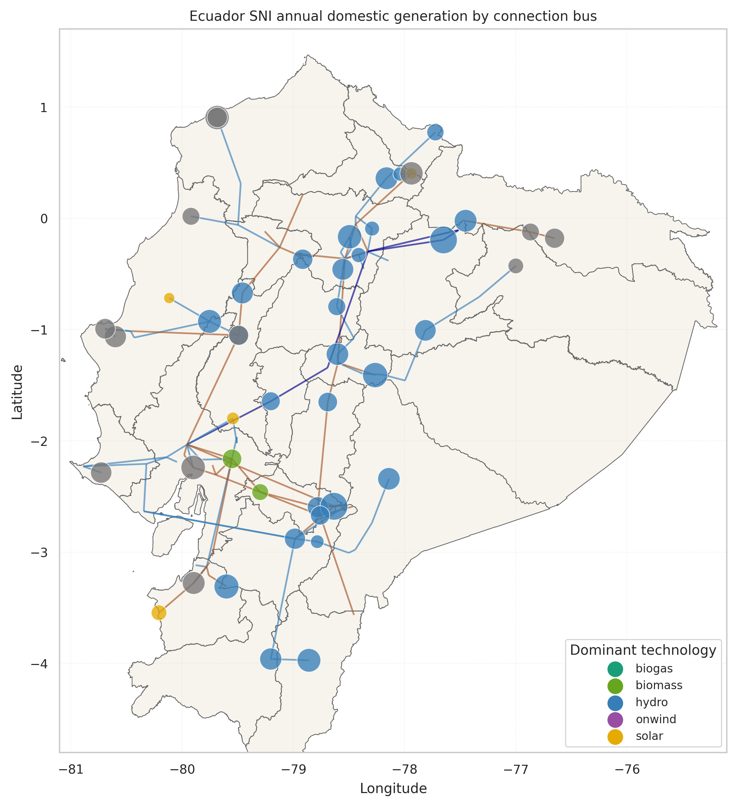
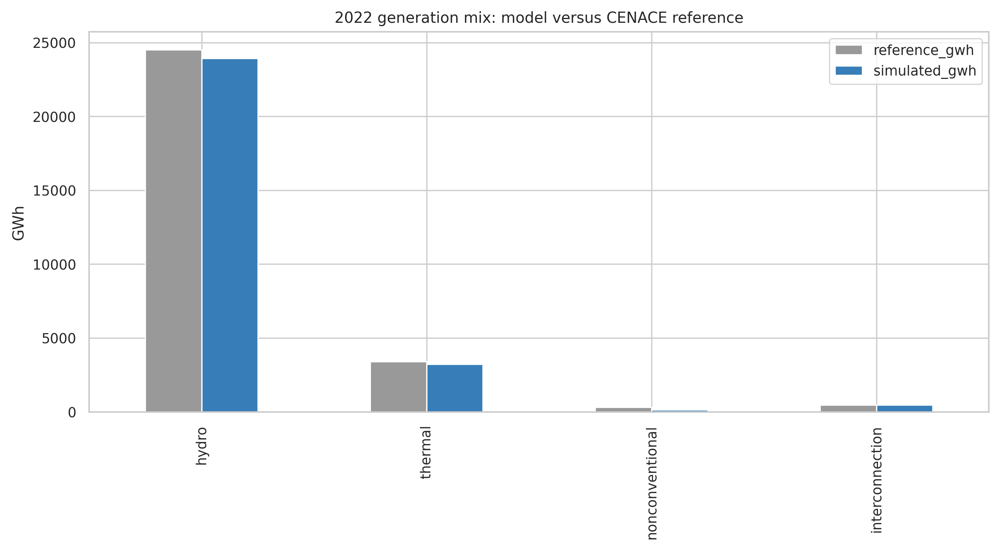
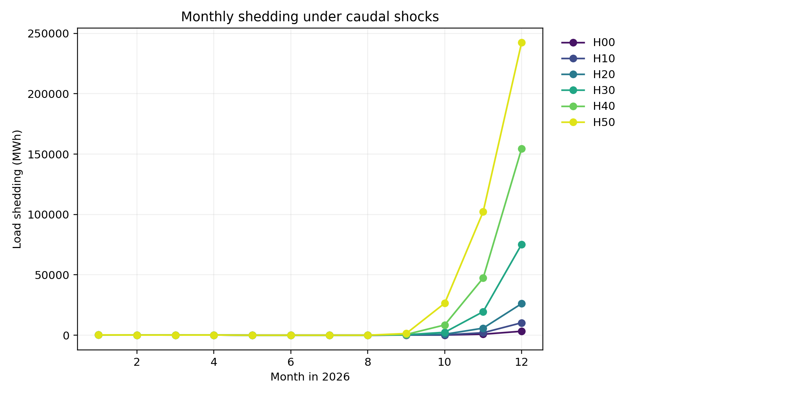

# EcuadorElectricGrid

Open, notebook-led PyPSA teaching and research model of Ecuador's mainland
interconnected electricity system (SNI). The repository turns public demand,
generation, network, hydrology, and planning evidence into a documented 2022
network model, then reuses it for transparent future-demand and hydro-stress
screening exercises.

## Results at a glance

The Phase 11 Docker execution completed all eleven notebooks at source commit
[`099ab5bbc7f41e942d89836a280c285851c4c4f2`](https://github.com/Fernando3161/EcuadorElectricGrid/commit/099ab5bbc7f41e942d89836a280c285851c4c4f2).
It includes the 2022 baseline, two 2030 demand cases, and six 2026 seasonal
hydro-shortage sensitivities. The saved baseline has **zero modeled load
shedding**, providing a clear no-shedding starting point for further exercises.



*2022 model: annual domestic dispatched generation by bus. Imports and the
artificial load-shedding generators are excluded from this map.*



*CENACE 2022 reference versus the 2022 model by validation carrier. This is an
internal consistency and historical-comparison check, not proof of full
historical validation. The current baseline passes the aggregate TVD screen but
does not pass the configured nonconventional-carrier share screen; see the
results record for the complete interpretation.*



*Monthly modeled unserved energy in the deterministic 2026 hydro-shortage
sensitivity. H00–H50 reduce selected September–December hydro-flow inputs by
0–50%; the plot shows how modeled shedding becomes concentrated in the imposed
late-year stress season. It is a sensitivity result, not an El Niño forecast or
a probabilistic adequacy metric.*

## Data and reproducibility records

Two versioned Zenodo records support the workflow:

- [Input network and weather objects (NetCDF)](https://doi.org/10.5281/zenodo.23392049) — external input artifacts retrieved and checked by `config/artifacts.yaml`.
- [Phase 11 completed Docker run and results](https://doi.org/10.5281/zenodo.23726852) — executed notebooks, logs, solved networks, figures, reporting tables, and provenance for the results summarized above.

The results record is the authoritative evidence for the completed run. It
records the resolved source commit, environment-specification hash, artifact
inventory, and notebook status. It demonstrates one successful Docker
execution; it does not by itself establish an independent replication, AC
security, or probabilistic adequacy.

## Run the model

The supported notebooks run sequentially from the repository root in the
existing `pypsa-earth-ec` Conda environment. Do not create a repository-local
environment. The preflight reads `config/artifacts.yaml`, validates every input
required by a stage, retrieves missing external artifacts where configured, and
checks size and SHA-256 before scientific processing begins.

```powershell
conda activate pypsa-earth-ec
python -m src.preflight --stage 00_preflight
```

For the full Docker workflow:

```powershell
.\scripts\run_docker_repro.ps1
```

To reproduce the published Phase 11 run exactly, explicitly select its recorded
commit rather than relying on a moving branch name:

```powershell
.\scripts\run_docker_repro.ps1 -RepositoryRef 099ab5bbc7f41e942d89836a280c285851c4c4f2
```

New outputs are exported under `results/docker_runs/`. They are intentionally
not committed; publish or archive a completed run separately with its metadata,
logs, inventory, solved networks, and reports.

## Supported notebook sequence

1. `00_preflight_and_data_inventory.ipynb`
2. `01_prepare_2022_demand.ipynb`
3. `02_prepare_2022_generation.ipynb`
4. `03_prepare_renewable_and_hydro_profiles.ipynb`
5. `04_build_and_validate_2022_topology.ipynb`
6. `05_assemble_and_smoke_test_2022_network.ipynb`
7. `06_run_and_validate_2022_full_year.ipynb`
8. `06a_diagnose_2022_validation.ipynb`
9. `07_prepare_master_plan_expansion.ipynb`
10. `08_future_masterplan_screening.ipynb`
11. `08a_hydro_shortage_2026.ipynb`

Later notebooks consume the staged products from earlier notebooks. The model
boundary, carrier taxonomy, acceptance screens, units, source references, and
engineering assumptions are documented in `config/validation_2022.yaml` and in
the notebooks. See `LICENSE` for Apache-2.0 reuse terms.
