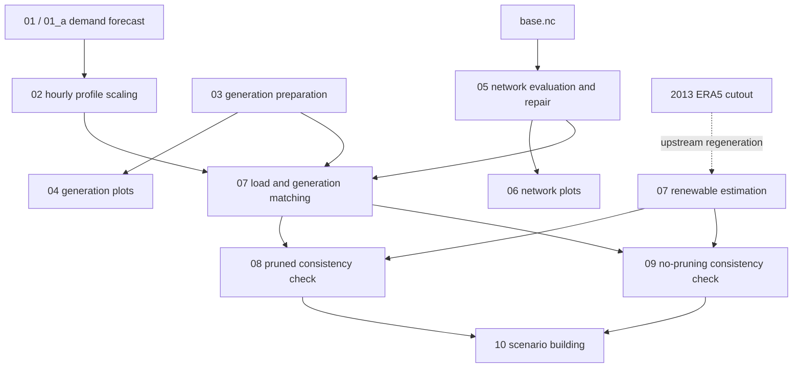
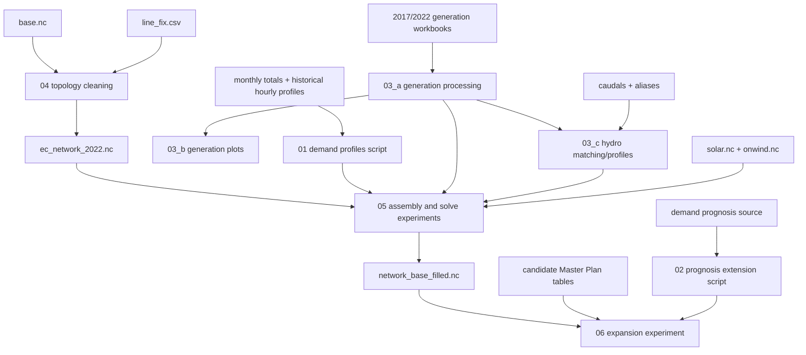

# Notebook lineage and migration map

## Purpose

This document maps the two development histories that must be reconstructed. It
records dependencies and reusable evidence; it does not declare either chain a
supported or validated workflow.

## Legacy 2017/2018 lineage

The strongest execution evidence is the nearly fully executed no-pruning
notebook. The pruned notebook contains broader diagnostic and mutation logic but
ends with a saved error. Both must be mined: one is not a substitute for the
other.

| Notebook | Evidence to preserve | Known limitation |
|---|---|---|
| `01_a_EC_year_demand_forecast.ipynb` | scenario projection formulas | legacy years and assumptions |
| `01_EC_year_demand_forecast.ipynb` | simpler forecast path and plot | overlaps `01_a` |
| `02_EC_profiles_forecast.ipynb` | hourly scaling and total checks | outputs a large family of scenario files |
| `03_EC_generation.ipynb` | plant conversion/mapping logic | saved import error |
| `04_EC_generation_plots.ipynb` | capacity diagnostics | presentation mixed with preparation |
| `05_EC_network_eval.ipynb` | topology checks, repair and expansion logic | saved API error; mutations not yet formalized |
| `06_EC_network_plots.ipynb` | comparison plots for network variants | includes obsolete nuclear variants |
| `07_EC_load_n_gen_match.ipynb` | attachment rules | saved API error |
| `07_EC_renewables_estimation.ipynb` | provenance for `solar.nc`/`onwind.nc` | cutout generation belongs upstream; saved interrupts |
| `07_EC_saved.ipynb` | scratch logic requiring uniqueness review | unexecuted and mixed concerns |
| `08_2017_Consistency_Check.ipynb` | pruning, checks, assembly, solve, output tables | final saved `KeyError` |
| `08_EC_cluster_network copy.ipynb` | line/transformer reactance experiment | single-purpose copy |
| `09_2017_Consistency_Check_no_pruning.ipynb` | most complete successful consistency path | legacy boundary and inputs |
| `10_EC_Scenario_Building.ipynb` | generic KPI/reporting patterns | premature and obsolete scenario assumptions |
| `10_EC_Scenario_Building copy.ipynb` | comparison evidence for the original | copied implementation |
| `999_Vietnam.ipynb`, `test.ipynb` | no Ecuador scientific role identified | Phase 10 removal candidates |

## Current 2022 lineage

| Current file | Inputs | Outputs/evidence | Target stage |
|---|---|---|---|
| `01_generate_demand_profiles_2022.py` | monthly totals, historical hourly profiles | legacy kW profile and plots | replaced by `01_prepare_2022_demand.ipynb` plus `src/demand.py`; retain until Phase 10 |
| `02_extend_demand_prognosis.py` | planning demand prognosis | extended yearly prognosis | Phase 8 planning/scenario preparation, not baseline demand |
| `03_a_process_generation.ipynb` | source generation workbooks, canton references, renewable-future CSV | cleaned existing/future workbooks | `02_prepare_2022_generation.ipynb` |
| `03_b_generation_plots.ipynb` | cleaned existing generation | technology-capacity plot | merge into Stage 02 validation |
| `03_c_hydro_profiles.ipynb` | flow table, aliases, cleaned plants | hourly hydro profiles and match audits | `03_prepare_renewable_and_hydro_profiles.ipynb` |
| `04_EC_network_base.ipynb` | `base.nc`, line fixes | orphan report, `ec_network_2022.nc` | `04_build_and_validate_2022_topology.ipynb` |
| `05_EC_network_base_run.ipynb` | cleaned network, demand, plants, costs, profiles | attachment audits, filled network, experimental solves | split between Stages 05 and 06 |
| `06_EC_network_expansion_run - Kopie.ipynb` | filled network plus candidate expansion tables | skip reports and experimental future solve | reconstruct in Stages 07–09; saved `IndexError` |
| `06_EC_network_plots.ipynb` | candidate networks and boundary geometry | grid plots | topology/reporting functions |

## Generated notebook-directory artifacts

The files currently beside the notebooks are outputs, not notebook inputs of
record. Their target locations are:

| Current outputs | Meaning | Target zone |
|---|---|---|
| `removed_orphan_buses.csv`, `lv_only_buses.csv`, `lv_only_buses_by_subnetwork.json` | topology/pruning audit | `data/interim/topology/` |
| `buses_final_2022.csv`, `lines_final_2022.csv`, `transformers_final_2022.csv`, `network_lines.csv`, `lines_data.csv` | component snapshots | run-specific diagnostics under `results/` |
| `ppl_attached.csv`, `cantons_not_found.csv` | plant/location matching audit | `data/interim/generation/` |
| `loads_p_set.csv`, `generators_t_pmax_pu.csv` | large generated time series | `data/interim/` or run directory, never beside notebooks |
| `generators_postopt.csv`, `load_shedding_buses.csv` | solve diagnostics | `results/runs/<run_id>/tables/` |
| `skipped_expansion_lines.csv`, `skipped_expansion_trafos.csv`, `EC_line_expansion_masterplan_nreport.csv` | expansion-application audit | `data/interim/planning/` or run directory |

They remain in place during Phase 1 because some are the only explicit record of
earlier pruning and attachment decisions.

## Crosswalk to the supported notebook series

| Target notebook | Primary evidence sources |
|---|---|
| `00_preflight_and_data_inventory.ipynb` | Phase 0 artifact audit and Phase 1 schemas |
| `01_prepare_2022_demand.ipynb` | current demand scripts plus legacy Notebooks 01–02 |
| `02_prepare_2022_generation.ipynb` | current Notebooks 03_a–03_b and legacy 03–04 |
| `03_prepare_renewable_and_hydro_profiles.ipynb` | current 03_c and legacy renewable estimation |
| `04_build_and_validate_2022_topology.ipynb` | current 04, legacy 05–06, both `line_fix.csv` files |
| `05_assemble_and_smoke_test_2022_network.ipynb` | current 05 and legacy 07–09 |
| `06_run_and_validate_2022_full_year.ipynb` | legacy consistency/accounting patterns plus Phase 3 validation contract |
| `07_prepare_master_plan_expansions.ipynb` | current expansion tables/notebook and source PDFs/workbooks |
| `08_build_future_scenario.ipynb` | rebuilt declarative interface; not the existing registry |
| `09_compare_scenarios.ipynb` | generic legacy KPI/plot patterns after baseline validation |

## Code lineage risks

- `src/helpers.py` uses non-package imports for scenario/path modules and combines
  unrelated concerns. Functions will be extracted rather than treating the file
  as a stable API.
- the old scenario modules contain useful mechanics but center a scenario catalog
  that predates baseline validation;
- legacy scenario notebooks refer to module locations that no longer exist;
- saved notebook output may include obsolete paths, stale state, and errors;
  source cells and regenerated outputs must be reviewed separately.

The machine-readable notebook disposition is in
`config/repository_inventory.json` and is checked by the Phase 1 tests.

## Phase 3 migration result

`notebooks/01_prepare_2022_demand.ipynb` is now the supported Stage 01 entry
point. It uses common preflight, writes a unit-explicit MW profile, validates
energy/peak/time/spatial invariants, saves report figures, and materializes the
normalized CENACE supply reference. Future demand projection remains assigned to
the planning/scenario phase and is not a baseline dependency.

## Phase 4 migration result

`notebooks/02_prepare_2022_generation.ipynb` now replaces the supported role of
the giant legacy generation-processing and plotting cells. It consumes tracked
open tables, enforces a one-to-one location join, reconciles exactly to 133 SNI
source rows, and saves capacity and location-evidence figures.

`notebooks/03_prepare_renewable_and_hydro_profiles.ipynb` replaces automatic
hydro fuzzy matching with a fixed reviewed assignment table and attaches the
published 2013 solar/wind province profiles to the 2022 model calendar. Reusable
logic is in `src/generation.py` and `src/availability.py`. The old notebooks and
their generated outputs remain evidence until the Phase 10 pruning review.

## Phase 5 migration result

`notebooks/04_build_and_validate_2022_topology.ipynb` replaces the mutation cells
in the current topology notebook. `src/topology.py` now snaps the two off-standard
voltage groups, removes 18 true orphans, applies the 138/230/500 kV boundary,
adds five reviewed legacy corridors, patches zero transformer resistance through
an explicit modeling-assumption row, and reports four connected components.

`notebooks/05_assemble_and_smoke_test_2022_network.ipynb` replaces the assembly
portion of the current base-run notebook. `src/assembly.py` preserves all Stage 1
demand rather than dropping lower-voltage load, attaches all 251 load series and
133 existing generators with row-level distance audits, adds the Phase 4
availability profiles and explicitly separated emergency load shedding, and
verifies the unsolved candidate through a NetCDF round trip. Experimental solve
and post-solve cells remain evidence for Phase 6 and are not executed in Phase 5.
