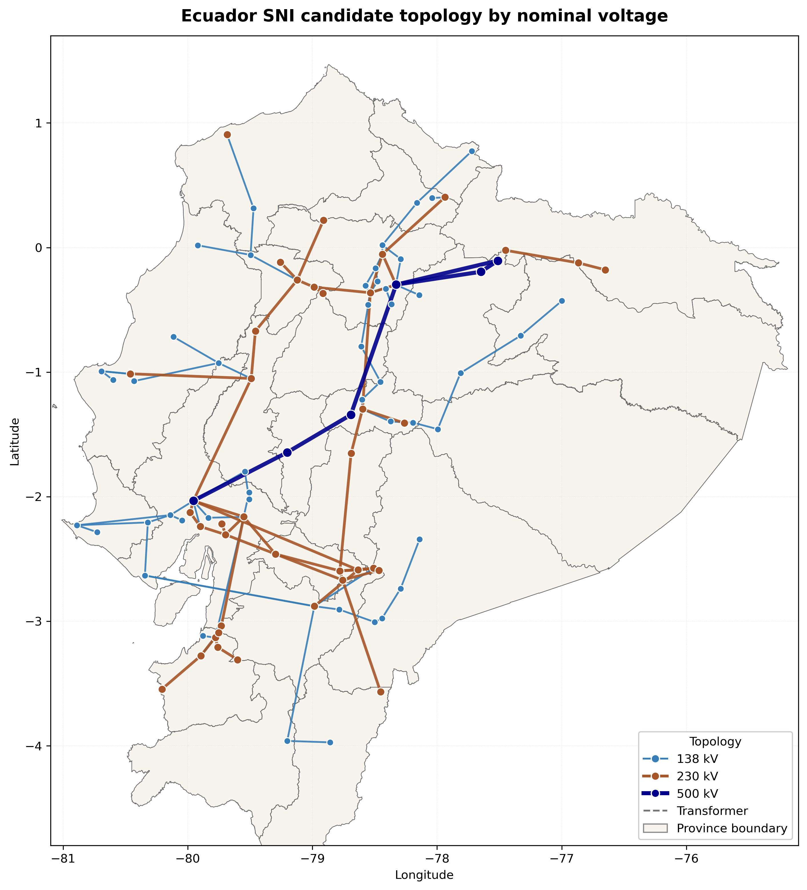
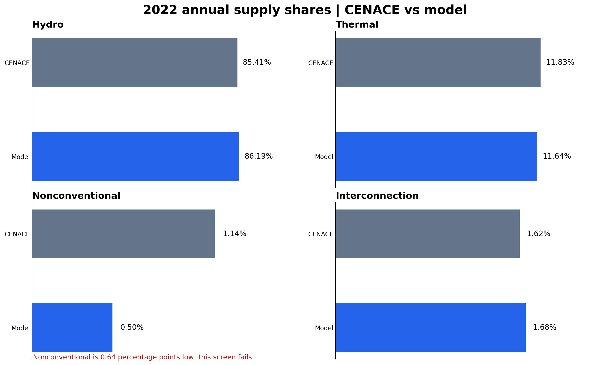
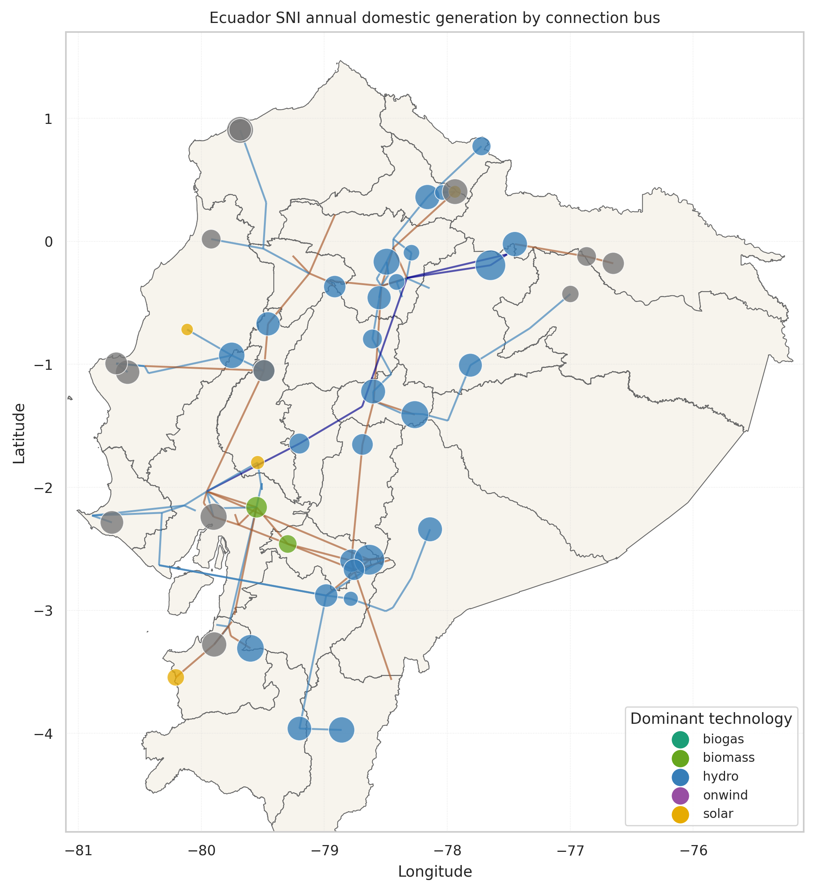
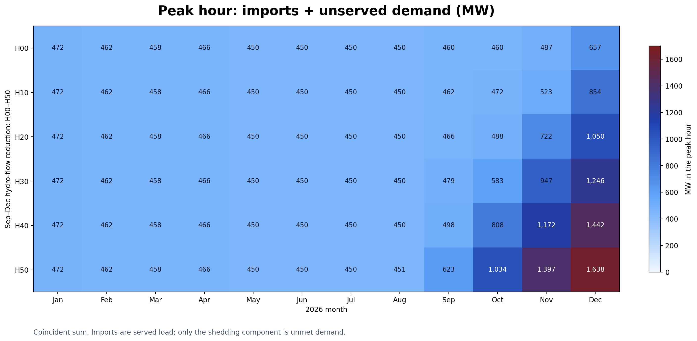
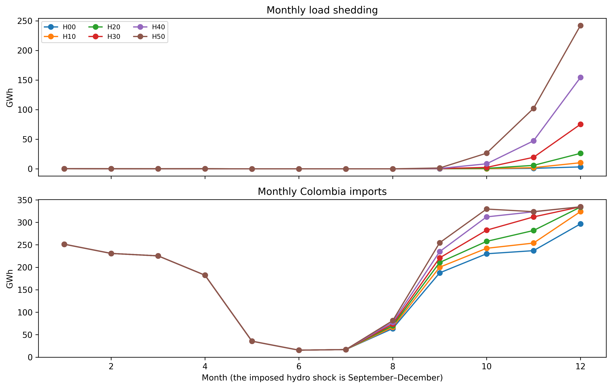
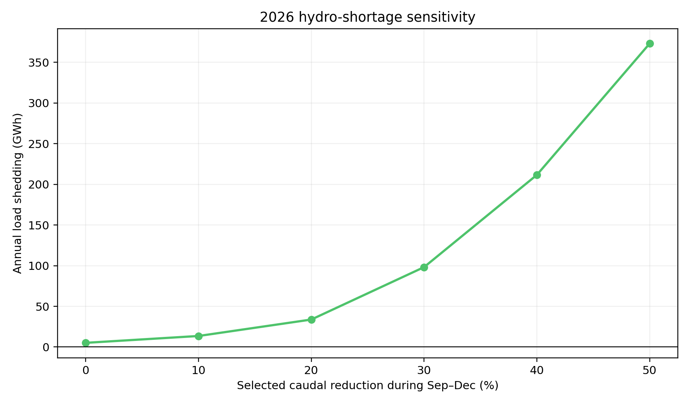
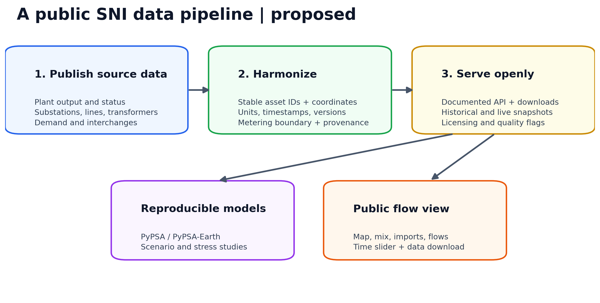
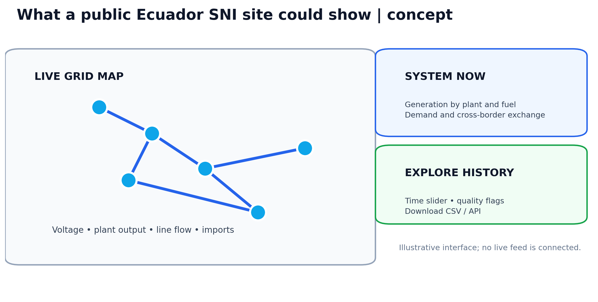

# Ecuador SNI: three LinkedIn posts

The text under **Text to paste** is written as three standalone posts. Upload the adjacent PNGs as a LinkedIn carousel or separate images; LinkedIn does not embed Markdown image syntax when text is pasted. The figures below are embedded in this file for review.

## Post 1 — Building a usable 2022 grid model

### Text to paste

I built an open, notebook-led model of Ecuador’s mainland electricity grid. The network map is the visible result; getting the data to agree was the real work.

I started from a PyPSA-Earth transmission network, then reconciled 2022 plant records, bus locations, voltage levels, CENACE demand and generation tables, hydro inflows, and ERA5-derived renewable cutouts. The weather profiles retain their 2013 source year, so I treat them as modeling inputs rather than observed 2022 weather. Plant and load connections, commissioning dates, carrier labels, and metering boundaries all needed explicit decisions and provenance.

The baseline has useful internal consistency. The modeled topology connects the main voltage levels, and the annual supply shares broadly track CENACE’s 2022 mix: hydro is 86.19% in the model versus 85.41% in the reference; thermal is 11.64% versus 11.83%. But nonconventional generation is underrepresented: 0.50% versus 1.14%, a miss of 0.64 percentage points. That is an open issue to investigate, not a detail to hide.

The demand accounting deserves equal care. Model domestic demand is calibrated to CENACE’s 27,561.62 GWh; the remaining 931.43 GWh gap is between the reported supply and the demand-plus-exports accounting boundary. CENACE explicitly refers to transmission-system losses in its demand discussion, but I have not established that the full gap is losses. Reconciling definitions and meter locations is part of the next validation step.

This is a transparent research model with a coherent topology and useful historical comparisons. It is not a formally validated digital twin. I’m interested in working with people who have better plant, network, or metering data to improve it.

Project and reproducible results: https://github.com/Fernando3161/EcuadorElectricGrid | https://doi.org/10.5281/zenodo.23726852

#PyPSAEarth #PyPSA #OpenEnergyModelling #Ecuador #PowerSystems #EnergyData

### Figures to upload

**1. Modeled transmission network by voltage level.** Candidate topology with 138, 230, and 500 kV lines; it is a model view, not a geographic verification of every physical asset.

**2. Annual supply shares.** The nonconventional category is visibly below CENACE’s reference share.

**3. Modeled annual domestic generation by connection bus.** Bubble area shows annual generation; color marks the dominant technology. Imports and artificial shedding are excluded.

## Post 2 — Hydro scarcity and the value of flexibility

### Text to paste

What happens to Ecuador’s electricity system when several major hydro inflows fall at the same time?

I used the open PyPSA model to run six deterministic 2026 sensitivities. In H00–H50, selected hydro-flow inputs are reduced by 0–50% from September through December. This is a stress test built on stated assumptions, not a weather forecast or a probability of blackouts.

The response is strongly nonlinear. Annual modeled unserved energy rises from 5.13 GWh in H00 to 373.06 GWh in H50. In December’s worst H50 hour, 1,188 MW of demand is unserved while 450 MW is imported from Colombia. The coincident **import-plus-unserved-demand exposure** is therefore about **1,638 MW**. Calling all 1,638 MW “unserved demand” would be incorrect: the imports are serving load.

The monthly plots show why this matters operationally. Stress concentrates late in the year; thermal generation and imports buffer falling hydro output, but their modeled flexibility is finite. H50 uses about 2.28 TWh of imports over the year, compared with 1.98 TWh in H00. Even the no-shock H00 scenario has some modeled shedding, so the figures should be read as sensitivity results rather than a clean threshold.

The wider concern is real. A September 2026 ministry memo, reported by Ecuavisa, cited a need for 1,391 MW of additional capacity for the dry season. That capacity figure and my model’s hourly 1,638 MW exposure use different definitions; their numerical proximity is not validation. The model’s value is in making the assumptions and consequences inspectable so future scenarios can be tested, then checked against better operational evidence.

Model and result bundle: https://github.com/Fernando3161/EcuadorElectricGrid | https://doi.org/10.5281/zenodo.23726852

Reported ministry memo: https://www.ecuavisa.com/ecuador/cenace-energia-deficit-crisis-energetica-ecuador-megavatios-estiaje-20260925-0076.html

#PyPSA #PyPSAEarth #Hydropower #EnergySecurity #Ecuador #OpenEnergyModelling

### Figures to upload

**1. Peak-hour heatmap (MW).** Each cell is the monthly maximum of coincident Colombia imports plus unserved demand. H50 reaches 1,638 MW in December; only 1,188 MW of that peak is shedding.

**2. Monthly unserved energy and imports (GWh).** The upper panel is shedding; the lower panel is Colombia imports. These are monthly energy totals, not peak power.

**3. Annual stress response (GWh).** More severe flow reductions produce a nonlinear increase in modeled shedding.

## Post 3 — What this project made me wish existed

### Text to paste

Building the Ecuador model taught me that open energy modeling depends as much on data infrastructure as on optimization.

The hardest recurring tasks were joining plant names to stable IDs, locating assets and their grid connections, reconciling generation and demand boundaries, finding the right vintage of a network, and tracing every correction back to a source. Each task is manageable once. Repeating it for every new study wastes time and makes comparisons harder.

I would like to help build a public, open-data layer for Ecuador’s Sistema Nacional Interconectado: time-stamped generation by plant; versioned transmission and distribution network models with clear asset IDs; demand and cross-border exchanges; documented units, licenses, quality flags, and provenance; and a public site where anyone can explore SNI energy flows and download the underlying data.

This would extend existing public efforts, not start from zero. CENACE already publishes operational information. Chile’s Coordinador Eléctrico Nacional offers real-time system views and downloadable plant and line data; ENTSO-E publishes generation, load, and cross-border-flow datasets through a transparency platform. Ecuador could develop an approach suited to its own institutions and data rights.

The two diagrams are a proposal, not a claim that such a live Ecuador platform already exists. If you work in system operation, utilities, research, open data, or civic technology and want to help define a practical first release, let’s talk. A credible first step could be a shared plant-and-substation registry, with timestamps and provenance, before adding live flows.

Current Ecuador operational information: https://www.cenace.gob.ec/info-operativa/InformacionOperativa.htm

Examples: https://www.coordinador.cl/reportes-y-estadisticas/ | https://www.entsoe.eu/data/transparency-platform/

#OpenEnergyData #Ecuador #SNI #PyPSAEarth #PyPSA #EnergyTransition #OpenSource

### Figures to upload

**1. Proposed public data pipeline.** Stable IDs, metering boundaries, timestamps, and provenance connect operational sources to both research models and a public view.

**2. Public SNI site concept.** Illustrative interface only; no live feed is connected.

## Evidence and interpretation notes

- The 2022 figures and shares come from the completed [Phase 11 result record](https://doi.org/10.5281/zenodo.23726852), especially `results/phase_06/validation_2022.csv` and `results/phase_06/validation_summary.json`. The baseline passes its aggregate total-variation-distance screen but fails the configured nonconventional share screen. The comparison is partial; it is not formal historical validation.
- The 2022 accounting residual is recorded in `config/validation_2022.yaml` as **report only, not modeled as losses**. [CENACE’s 2022 annual report](https://www.cenace.gob.ec/informe-anual-2022/) reports the generation and demand series and labels national demand as including SNT losses. That alone does not attribute the complete residual.
- The hydro figures use `analysis/phase08a_annual_kpis.csv` and `analysis/phase08a_monthly_kpis.csv` in the completed run. H50’s 1,637.85 MW combined peak consists of 1,187.85 MW shedding and 450 MW imports in the same hour. H50’s 373.06 GWh is annual unserved **energy**, not peak power. The scenarios are deterministic and use the model’s capped Colombia interface.
- The [September 2026 capacity-gap reporting](https://www.ecuavisa.com/ecuador/cenace-energia-deficit-crisis-energetica-ecuador-megavatios-estiaje-20260925-0076.html) cites ministry memo `MAE-VEER-2026-0505-OF`; the memo itself was not publicly available in the sources reviewed here. Separately, [CENACE’s 2024 accountability report](https://www.cenace.gob.ec/wp-content/uploads/2025/03/Informe-de-rendicion-de-cuentas-2024_CENACE_final-rev.pdf) discusses 1,080 MW of new firm thermal generation. Neither external capacity figure is the same metric as model shedding or import-plus-shedding exposure. The proposed “CENACE 1,500 MW” statement is therefore not used.
- Public-site examples were checked against [CENACE’s operational portal](https://www.cenace.gob.ec/info-operativa/InformacionOperativa.htm), [Chile’s operator data portal](https://www.coordinador.cl/reportes-y-estadisticas/), and [ENTSO-E’s Transparency Platform](https://www.entsoe.eu/data/transparency-platform/). The diagrams in post 3 are proposals.

Regenerate the PNGs with `python scripts/build_linkedin_figures.py` from a checkout containing the Phase 11 result bundle.
