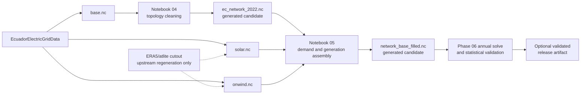

# Phase 00 technical report

## Report metadata

- Phase: 00 — Forensic diagnostic and governing documentation
- Branch: `refactor/v1-phase-00-diagnostic`
- Starting revision: `b628b47`
- Author: Codex, under repository-owner direction
- Reviewer: repository owner; final review pending
- Date: 2026-10-15
- Environment: existing `pypsa-earth-ec` Conda environment
- Observed runtime: Python 3.11.14, PyPSA 0.30.3, pandas 2.3.3,
  NumPy 1.26.4, xarray 2025.1.2, HiGHS bindings available
- Platform: Windows/PowerShell reference development system

## Objective and acceptance criteria

Phase 00 establishes an evidence-based starting point and the rules for the full
refactor. It does not clean the repository or change scientific behavior.

| Acceptance criterion | Status | Evidence |
|---|---|---|
| Root agent guidance exists | Pass | `AGENTS.md` |
| Root README states actual project status | Pass | `README.md` |
| Objectives, workflow, data contract, plan, and report template exist | Pass | `docs/` documentation set |
| Full diagnostic records evidence, gaps, and risks | Pass | `docs/PHASE_00_DIAGNOSTIC.md` |
| Notebook-led student architecture is defined | Pass | objectives, workflow, and project plan |
| Existing environment is identified without creating/installing another | Pass | read-only environment probe |
| Required external NetCDF boundary is identified | Pass | `base.nc`, `solar.nc`, and `onwind.nc` only |
| Processed networks are classified correctly | Pass | notebook writer tracing |
| Phase and branch sequence is defined | Pass | Phases 00–10 in `docs/PROJECT_PLAN.md` |
| Owner approves the complete Phase 00 package | Pending | requires review of this report and branch diff |

Phase 00 is implementation-complete and ready for owner review. It must not be
reported as formally closed until that review occurs.

## Inputs and provenance

The diagnostic inspected the tracked repository at revision `b628b47`, all
tracked notebooks and source files, ignored NetCDF artifacts present during the
audit, relevant Git history/branches, and the companion
`Fernando3161/EcuadorElectricGridData` documentation.

The three required upstream NetCDF inputs were structurally inspected and hashed:

| Artifact ID | Repository destination | Bytes | SHA-256 observed during Phase 00 |
|---|---|---:|---|
| `pypsa_earth_base_ec` | `data/raw/networks/base.nc` | 1,346,893 | `376db45456d13049a9564947f1dac73bf96e6aff09fc5d0b30c07102ad1cf9af` |
| `renewable_profile_solar_ec` | `data/raw/cutouts/solar.nc` | 1,760,868 | `28c6ab3a6bd537869bf6811371d3bb76210fa744b4a11ef46205be91755578c1` |
| `renewable_profile_onwind_ec` | `data/raw/cutouts/onwind.nc` | 1,760,868 | `ace2b9524dec52f2235aabe1b398909f24f7c096f21a20d7f0dfb06c17922332` |

These hashes describe the files inspected in Phase 00. They are not release
checksums until Phase 02 verifies provenance and the owner publishes the approved
files under persistent URIs.

Source-document licensing and exact statistical-publication citations remain to
be completed in their planned phases. No third-party artifact was committed.

## Methods and decisions

The audit used read-only repository inventory, notebook JSON inspection, Git
history inspection, lightweight NetCDF/xarray/PyPSA loading, component counts,
saved-result dispatch aggregation, and dependency-string tracing.

Decisions established in Phase 00:

1. The student-facing workflow remains a sequence of explanatory notebooks.
2. Reusable scientific logic moves to small modules under `src/`.
3. The existing `pypsa-earth-ec` environment is mandatory; the refactor creates
   no replacement environment and installs no packages without approval.
4. Preflight must run before scientific stages and resolve the complete required
   artifact set.
5. The required upstream NetCDF set is `base.nc`, `solar.nc`, and `onwind.nc`.
6. The full ERA5/atlite cutout is an upstream regeneration artifact and is not a
   student-workflow dependency.
7. `ec_network_2022.nc` and `network_base_filled.nc` are generated products of
   the cleaning and assembly notebooks; their current instances are not source
   artifacts and must not be published as authoritative.
8. No 2022 network is called validated until the annual solve, energy balance,
   official statistical comparison, and fixed tolerance gate pass.
9. Official Master Plan data must be separated from hypothetical nuclear work.
10. The last phase performs evidence-backed deletion and records it in a dedicated
    reviewed commit.

No network mutation, carrier mapping, calibration rule, or tolerance formula was
introduced during this documentation phase.

## Implementation

Phase 00 added or rewrote:

- `AGENTS.md`;
- `README.md`;
- `docs/PROJECT_OBJECTIVES.md`;
- `docs/PHASE_00_DIAGNOSTIC.md`;
- `docs/PROJECT_PLAN.md`;
- `docs/DATA_AND_ARTIFACTS.md`;
- `docs/DEVELOPMENT_WORKFLOW.md`;
- `docs/TECHNICAL_REPORT_TEMPLATE.md`;
- this report.

No notebook, source module, configuration, dataset, network, or result artifact
was modified, moved, deleted, downloaded, uploaded, or regenerated.

## Tests and execution

Cheap/read-only checks performed:

- enumerated tracked repository files and file-type counts;
- inspected notebook cell types, execution counts, saved errors, paths, and
  writer/reader references;
- verified the approved environment imports PyPSA, pandas, NumPy, xarray, and
  HiGHS bindings;
- opened the three upstream NetCDF inputs and candidate/legacy networks without
  modifying them;
- inspected saved solved-network dispatch as non-authoritative evidence;
- traced all references to the full cutout and processed network filenames;
- verified documentation links and repository-relative destinations;
- scanned Markdown for workstation-specific filesystem locations;
- ran `git diff --check`.

No software test suite exists yet. Initial schema and path tests are a Phase 01
deliverable.

Not run:

- no notebook execution;
- no network optimization;
- no full-year scientific validation;
- no large download or weather-profile generation;
- no file deletion, relocation, or publication.

These omissions are intentional under the Phase 00 heavy-execution prohibition.

## Results

The tracked baseline contains 24 notebooks, 11 Python files, 46 CSV files, three
JSON files, and two YAML files. It contains two overlapping research chains: a
more complete 2017/2018 legacy chain and a partially completed 2022 chain.

Read-only network fingerprints and the provisional saved-result generation shares
are recorded in `docs/PHASE_00_DIAGNOSTIC.md`. They demonstrate useful prior work
and feasibility evidence but do not satisfy scientific validation.

The critical artifact classification is:

| Classification | Artifacts |
|---|---|
| Required upstream inputs | `base.nc`, `solar.nc`, `onwind.nc` |
| Upstream regeneration only | full ERA5/atlite cutout |
| Generated intermediate/candidate products | `ec_network_2022.nc`, `network_base_filled.nc` |
| Generated experimental results | solved networks under `results/` |

## Validation figures

The following diagram summarizes the verified artifact lineage. It is maintained
as text so it remains reviewable and does not introduce a generated binary during
the documentation phase.



The diagram answers which files are externally required, which are generated in
this repository, and why the full cutout is not part of the student preflight.

## Scientific validation table

Not applicable in Phase 00. The authoritative 2022 statistical source, system
boundary, carrier crosswalk, comparison formula, and small-carrier treatment are
Phase 03 deliverables. No Phase 00 metric is a scientific acceptance result.

## Limitations and unresolved issues

- The authoritative 2022 statistical publication and precise comparison boundary
  are not yet fixed.
- “Within 5%” still requires a formal metric and treatment of small/zero carriers.
- The starting processed network for Phase 05 remains evidence, not a canonical
  artifact.
- GDAL/ecCodes warnings and Jupyter kernel identity require later environment
  reconciliation.
- `config/environment_ec.yaml` contains apparent defects and is not a lock file.
- Exact source/license records for ignored PDFs and Excel files are incomplete.
- The existing manual corrections must be preserved before Phase 10 pruning.

These items are assigned to later phases and do not require Phase 00 to invent a
scientific answer.

## Reproducibility handoff

Review the Phase 00 branch with:

```powershell
git status --short --branch
git diff --check
git diff --stat
git diff -- AGENTS.md README.md docs reports
```

Because the new report is untracked until the owner stages or commits it, review it
directly in addition to the Git diff.

The owner should verify that the documented scope, environment policy, artifact
boundary, phase sequence, and open scientific decisions match the intended
handover. No heavy command is required for Phase 00 acceptance.

## Conclusion and next-phase recommendation

Phase 00 implementation is complete and awaits owner review. The next phase must
not begin until the owner accepts this report and the branch diff.

After acceptance, the safe next step is Phase 01 on
`refactor/v1-phase-01-structure`: inventory and classify every artifact, trace the
two notebook chains in detail, preserve manual scientific evidence, define the
target structure and schemas, and add the first cheap tests. Phase 01 must not yet
delete the legacy material it is still investigating.
