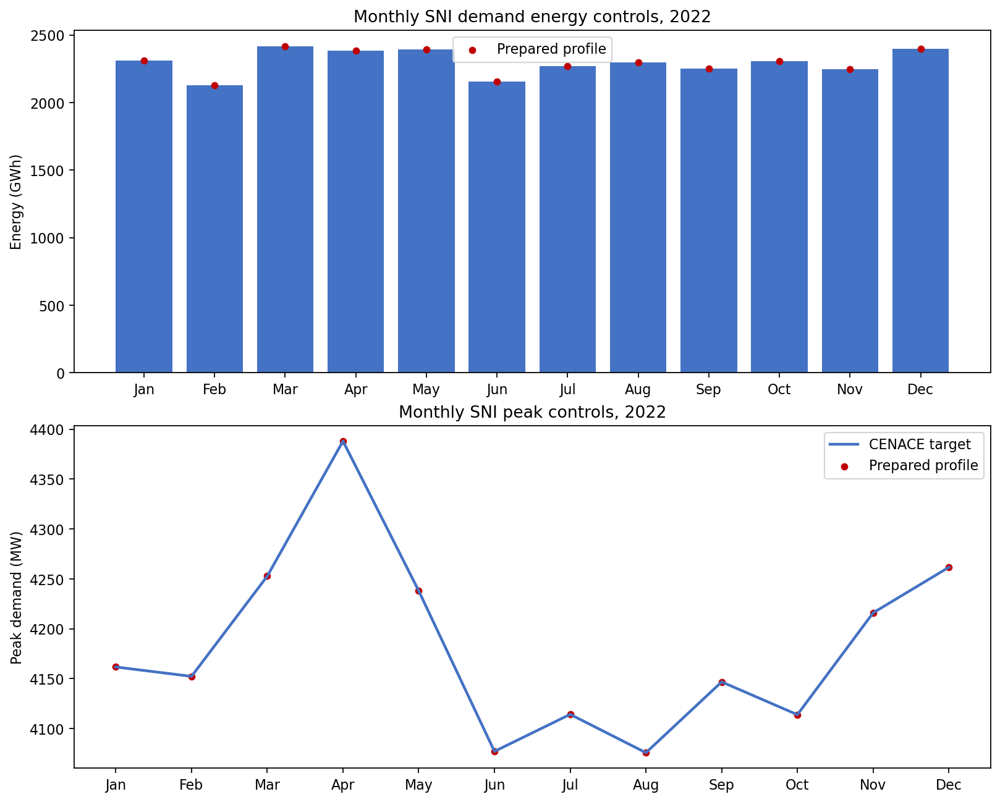
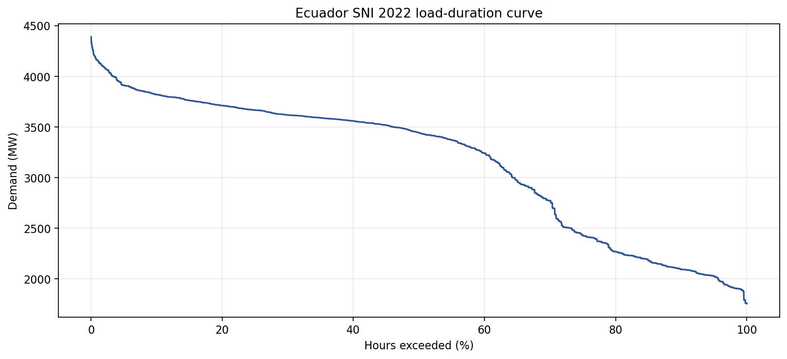

# Phase 03 technical report

## Report metadata

- Phase: 03 - Demand and statistical reference
- Branch: `refactor/v1-phase-03-demand-statistics`
- Starting revision: `7699f36`
- Author: Codex, under repository-owner direction
- Reviewer: repository owner; final review pending
- Date: 2026-10-15
- Environment: existing `pypsa-earth-ec` Conda environment
- Heavy execution: forbidden; no optimization was run

## Objective and acceptance criteria

Phase 03 must produce a reproducible 2022 demand profile and freeze the official
statistical comparison before model calibration.

| Acceptance criterion | Status | Evidence |
|---|---|---|
| Official demand and supply sources are identified | Pass | `config/validation_2022.yaml` and `docs/VALIDATION_2022.md` |
| SNI boundary, units, and time convention are explicit | Pass | validation contract and Stage 01 notebook |
| Hourly demand matches annual and monthly energy controls | Pass | tests and notebook diagnostics |
| Hourly demand matches every monthly peak control | Pass | tests and monthly validation figure |
| Spatial allocation is preserved and checked | Pass | maximum hourly bus-share change below numerical precision |
| Carrier taxonomy and crosswalk are fixed | Pass | raw and normalized statistical tables plus tested mappings |
| Imports, exports, storage, losses, and residual treatment are fixed | Pass | validation contract |
| Exact 5% formula and zero/small-carrier rules are tested | Pass | Phase 03 unit tests |
| Student-facing notebook runs through the approved environment | Pass | environment-pinned notebook execution |
| Owner accepts the complete phase | Pending | requires report and branch review |

## Source decisions

The carrier reference uses net SNI supply from CENACE's 2022 annual report,
Table 2.4. This aligns with the modeled mainland interconnected system and avoids
mixing in isolated-system generation. The source-faithful table retains each
published generation/fuel row and international imports by country.

The demand baseline uses CENACE national SNI demand: 27,561.62 GWh and a maximum
of 4,388.06 MW. Exact monthly values are taken from CENACE's 2023 report, which
republishes the 2022 values in Table 1.8.

Both CENACE reports are retained under `literature/CENACE/`. The validation
contract and source-document register record their repository-relative paths and
SHA-256 checksums, while the adjacent provenance note retains their official
publication URLs and verification details.

The legacy Master Plan monthly series was not discarded. It is documented as a
different-boundary planning series with a 1 GWh internal rounding discrepancy:
its displayed months total 28,180 GWh while the displayed annual total is
28,181 GWh. Using it as the operational baseline would mix source boundaries.

## Demand implementation

Reusable logic in `src/demand.py` validates the target schema, complete hourly
index, finite/non-negative values, units, monthly rounding reconciliation,
energy/peak calibration, and spatial preservation.

The prepared output uses MW directly. The legacy generated file remains in kW and
is not changed during this phase; the new unit-explicit output is generated as
`data/processed/demand/demand_profiles_2022_mw.csv` and is intentionally ignored
because it is a reproducible 40 MB product. Phase 5 must consume this new file and
must not apply the legacy `/1000` conversion.

The tracked 2013 template is an exact export of `loads_t.p_set` from its local
PyPSA-Earth 0.7.0 source network. The source metadata records weather year 2013,
prediction year 2030, SSP2-2.6, and upstream PyPSA-Earth commit
`4bfb13da0f24a5fc98f541babe00dfd72f7ba3f8`. Only its normalized hourly shape and
bus shares are used.

## Statistical contract

The normalized validation table is:

| Carrier | Reference (GWh) | Gate |
|---|---:|---|
| Hydro | 24,499.54 | 5% relative error |
| Wind | 57.00 | 5% relative error |
| Bioenergy | 235.74 | 5% relative error |
| Solar | 33.15 | 5% relative error |
| Non-renewable thermal | 3,393.35 | 5% relative error |
| Imports | 465.83 | 5% relative error |

The 0.01 GWh source rounding residual is visible but excluded from the carrier
gate. Exports (191.57 GWh), storage, losses, curtailment, and load shedding are
separate balance terms. Load shedding may not exceed 0.01 GWh in the eventual
accepted annual run.

All positive carriers use the same relative formula:

```text
100 * abs(simulated_gwh - reference_gwh) / reference_gwh <= 5.0
```

There is no small-positive-carrier exemption. A missing carrier is evaluated as
zero. The zero-reference fallback is an absolute 0.01 GWh numerical tolerance and
does not apply to the current positive carrier rows.

## Results

The executed Stage 01 notebook produced:

- 8,760 consecutive hourly timestamps for 2022;
- 251 bus columns;
- 27,561.62 GWh annual demand;
- 4,388.06 MW annual peak;
- zero missing values;
- zero negative values; and
- maximum hourly bus-share change of approximately `6.25e-17`.

Every monthly energy and peak error is below `1e-8` in its native unit. The 2022
year is non-leap and uses timezone-naive Ecuador local standard time, with no DST
shift.

## Validation figures

The target and prepared values overlap in the monthly control plot:



The prepared annual load-duration curve is:



## Tests and execution

Executed through the approved environment:

```powershell
python -m src.preflight --stage 01_demand --offline
python -m src.notebook_runner notebooks/01_prepare_2022_demand.ipynb --timeout 600
python -m unittest discover -s tests -v
```

The tests cover monthly table schemas, rounding reconciliation, hourly scaling,
peak calibration, exact annual energy, full-year index checks, leap-year rejection,
units, spatial shares, official-table aggregation, source residuals, carrier
mapping, missing carriers, 5% boundary behavior, and the zero-reference fallback.
All 46 discovered tests passed.

Not run:

- no PyPSA network mutation or assembly;
- no optimization or solver call;
- no annual carrier comparison against simulated results; and
- no scenario run.

## Limitations and handoff

- The hourly shape is a PyPSA-Earth modeling product, not measured 2022 SCADA
  demand. The official energy and peak controls constrain it, but they do not prove
  intraday chronology.
- The current generation data collapses several thermal fuels to `oil`. Phase 4
  should retain finer fuel evidence where available, while the frozen acceptance
  level remains `thermal_nonrenewable` unless a reviewed contract revision is made.
- Phase 5 must model imports explicitly or the positive 465.83 GWh import row will
  fail by design.
- The generated MW profile is reproducible and intentionally not committed. A
  fresh workflow creates it before network assembly.
- This phase defines the gate; it does not claim that the network passes it.

## Conclusion

Phase 03 is implementation-complete and ready for owner review. The demand stage
and statistical comparison are now machine-readable, independently tested, and
source-traceable. Phase 04 may prepare the existing generator fleet against this
frozen taxonomy; it must not tune or weaken the carrier gate.
