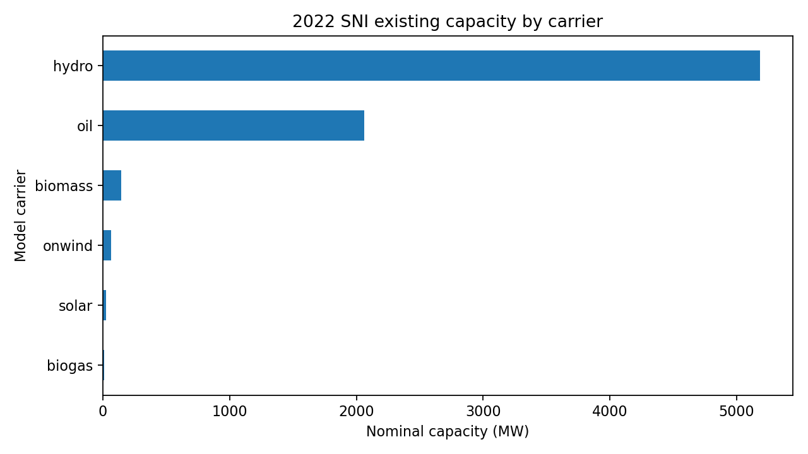
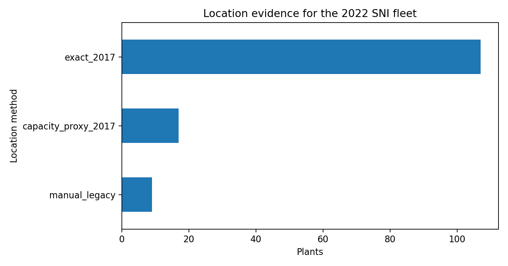
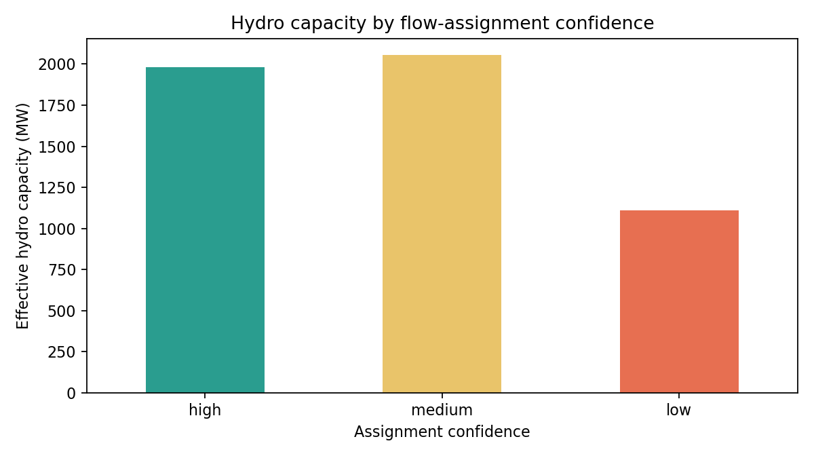
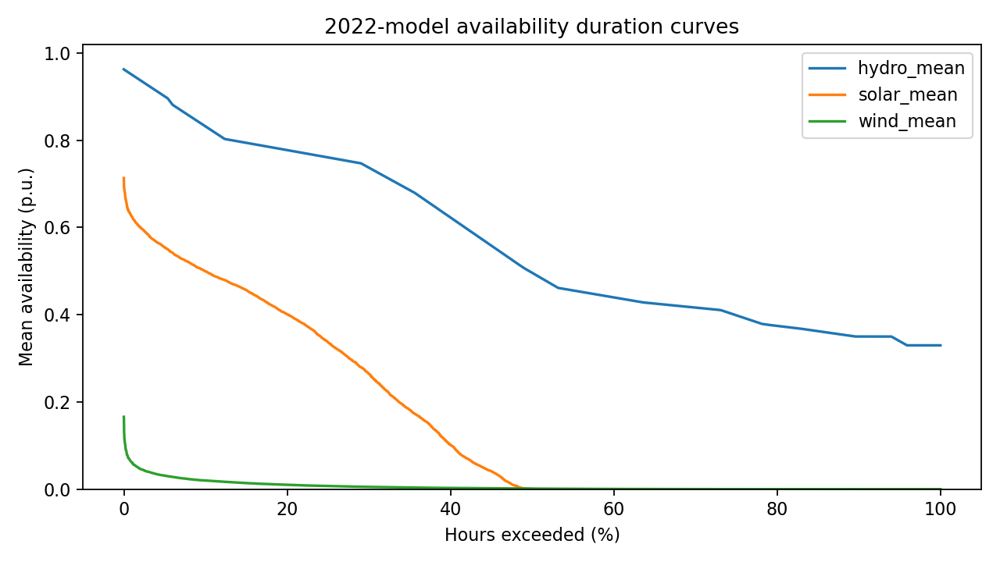
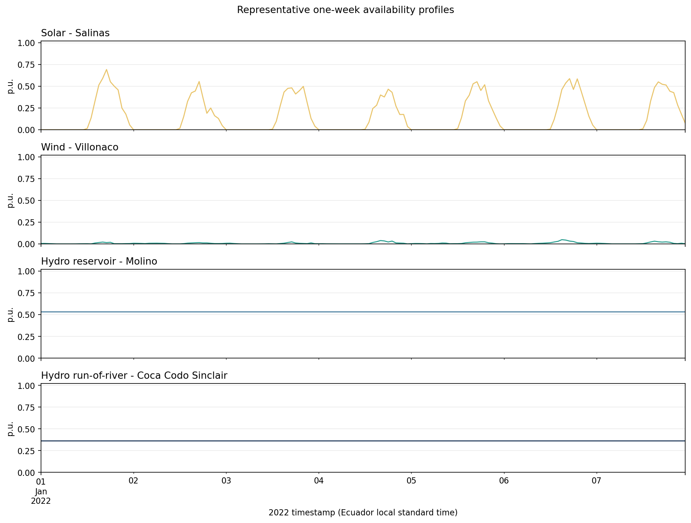

# Phase 04 technical report

## Report metadata

- Phase: 04 - Existing generation and availability profiles
- Branch: `refactor/v1-phase-04-generation-profiles`
- Starting revision: `8013f29`
- Author: Codex, under repository-owner direction
- Reviewer: repository owner; final review pending
- Date: 2026-10-15
- Environment: existing `pypsa-earth-ec` Conda environment
- Heavy execution: profile preparation only; no optimization was run

## Objective and acceptance criteria

| Acceptance criterion | Status | Evidence |
|---|---|---|
| Source-faithful existing fleet has row provenance | Pass | 300-row tracked source transcription and migration script |
| SNI fleet reconciles without duplicate capacity | Pass | 133 plants; 7,489.65 MW nominal; 7,175.11 MW effective |
| Stable identifiers and carrier mapping are complete | Pass | `src/generation.py` and Phase 04 tests |
| In-year generator additions are not available before operation | Pass | CENACE event table and profile-mask tests |
| Location evidence is one-to-one and qualified | Pass | 133-row location evidence table and method diagnostics |
| Every hydro plant has a reviewed assignment | Pass with limitation | 65 assignments; confidence explicitly reported |
| Hydro, solar, and wind profiles have complete time/plant coverage | Pass | executed Stage 03 notebook and tests |
| 2013 weather use in the 2022 model is explicit | Pass | Stage 03 notebook and methodology document |
| Future and hypothetical nuclear capacity are excluded | Pass | baseline-status checks and quarantined legacy tables |
| Validation plots are saved and report-linked | Pass | five figures under `reports/figures/phase_04/` |
| Owner accepts the complete phase | Pending | requires report and branch review |

## Fleet reconstruction

The ignored Excel workbook was migrated into a tracked, source-faithful CSV so a
fresh checkout does not require a private workbook. All 300 source rows retain
their original fields, workbook row, document ID, locator, and transcription
status. The supported Stage 02 filters only explicit SNI rows and never reads the
future-generation or nuclear-contaminated tables.

The earlier candidate workbook contained 137 rows and 7,493.65 MW nominal. That
was not a real source total: three duplicate `Loja/Gonzanama` canton rows caused
two source plants to be triplicated in a many-to-many merge, adding four rows and
4 MW. The new location interface is unique by source row and all merges are
validated one-to-one.

The accepted SNI capacity is:

| Carrier | Plants | Nominal MW | Effective MW |
|---|---:|---:|---:|
| Hydro | 65 | 5,184.19 | 5,144.61 |
| Oil / undifferentiated thermal | 37 | 2,061.88 | 1,796.82 |
| Biomass | 3 | 144.30 | 136.40 |
| Biogas | 2 | 8.32 | 7.20 |
| Onshore wind | 2 | 66.48 | 66.48 |
| Solar | 24 | 24.48 | 23.60 |



Location evidence consists of 107 exact 2017 matches, 9 retained manual canton
assignments, and 17 same-province capacity proxies. These coordinates support
later bus attachment but are not all equivalent geographic observations.



CENACE reports Sarapullo entering operation on 7 July 2022, Sabanilla on 1
December, and Huascachaca unit groups on 2 and 24 December. Stage 03 masks each
plant to zero before its earliest reported operating date. Published event
capacities are retained as separate evidence because they do not exactly match
the Master Plan plant capacities; no unsupported fractional trajectory is
invented for Huascachaca's staged entry.

## Availability profiles

The hydro method preserves the prior monthly-flow normalization while replacing
automatic/fuzzy matching with a fixed auditable table. Four plants have direct
plant/series evidence, five use the same hydrological system or generating
complex, and 56 retain low-confidence regional proxies. In effective capacity,
that is 1,980.00 MW high confidence, 2,053.90 MW medium confidence, and 1,110.71
MW low confidence.



Solar and wind use the checksum-pinned 2013 provincial NetCDF profiles already
published for the project. The 2013 chronology is positionally mapped to the
non-leap 2022 calendar. This provides a reproducible weather assumption but does
not validate 2022 meteorology.



The first week of 2022 is also shown for four deterministic representative
plants: Salinas solar, Villonaco wind, Molino reservoir hydro, and Coca Codo
Sinclair run-of-river hydro. The four panels share one time axis and a common
`[0, 1]` scale. The nearly constant hydro traces over one week are expected from
the monthly-flow interpolation method; the figure makes that temporal-resolution
limitation explicit.



The generated profiles contain 8,760 hours for 65 hydro, 24 solar, and 2 wind
plants. They have exact plant coverage, no missing values, and all values lie in
`[0, 1]`.

## Tests and execution

Executed through the approved environment:

```powershell
python -m src.preflight --stage 02_generation --offline
python -m src.notebook_runner notebooks/02_prepare_2022_generation.ipynb --timeout 600
python -m src.preflight --stage 03_profiles --offline
python -m src.notebook_runner notebooks/03_prepare_renewable_and_hydro_profiles.ipynb --timeout 600
python -m unittest discover -s tests -v
```

The tests cover source and normalized schemas, source-row uniqueness, exact
capacity reconciliation, carrier mapping, legitimate duplicate display names,
location coverage, future/nuclear exclusion, hydro assignment completeness,
profile bounds, full-year time alignment, and provincial solar/wind attachment.

The approved environment emitted non-failing optional-backend warnings for
`cfgrib`, GDAL data discovery, and a binary-size check while xarray discovered
installed backends. The required h5netcdf files still opened, passed structural
preflight, and produced valid profiles. No package was installed or changed.

Not run:

- no network mutation or generator-to-bus attachment;
- no optimization or solver call;
- no annual generation comparison against CENACE; and
- no future scenario or Master Plan expansion processing.

## Limitations and handoff

- The inventory is based on an owner transcription of the Master Plan, not a
  machine-extracted official table. The open CSV and migration script make this
  lineage reviewable.
- The raw workbook does not provide complete row-level commissioning or
  retirement years. Only three official 2022 additions are enriched; all older
  plants use a documented full-year-existing assumption.
- Thermal plants lack a reliable plant-level fuel split. Stage 06 compares them
  at the frozen non-renewable-thermal aggregate.
- Most hydro plant profiles use low-confidence regional proxies. Passing profile
  integrity checks does not make those profiles observed plant hydrology.
- 2013 weather is used for the 2022 simulation. A different weather-year study
  must be an explicit sensitivity, not a silent replacement.
- Phase 5 must use the location evidence when attaching generators and must not
  silently treat capacity proxies as exact sites.

## Conclusion

Phase 04 is implementation-complete and ready for owner review. The existing SNI
fleet and its availability profiles are now reproducible, source-linked, bounded,
and protected against future/nuclear leakage. Scientific validation of annual
carrier generation remains a Phase 06 acceptance gate.
