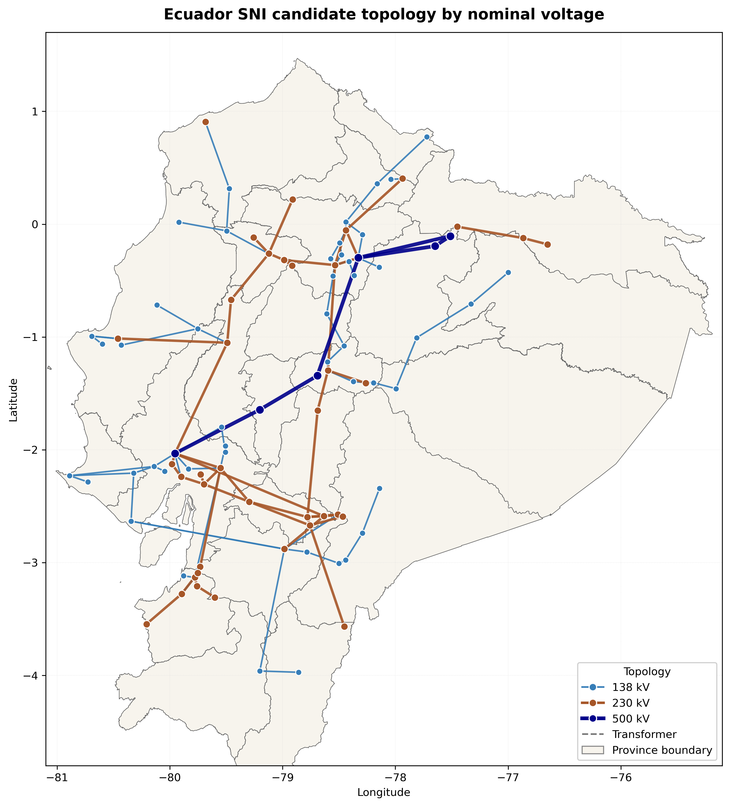
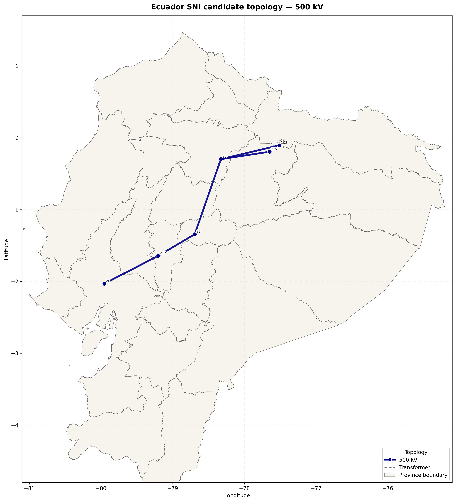
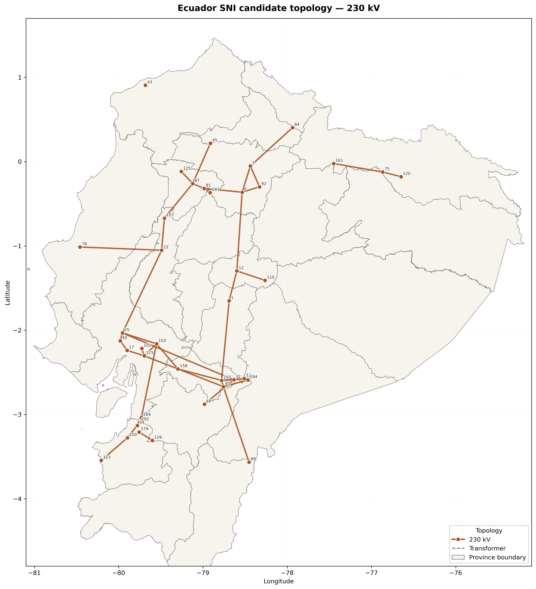
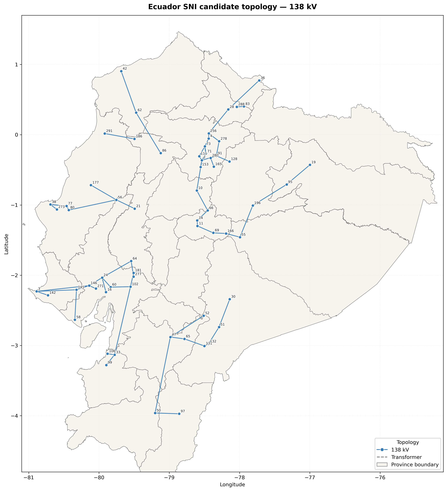
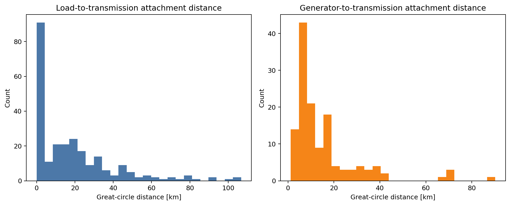
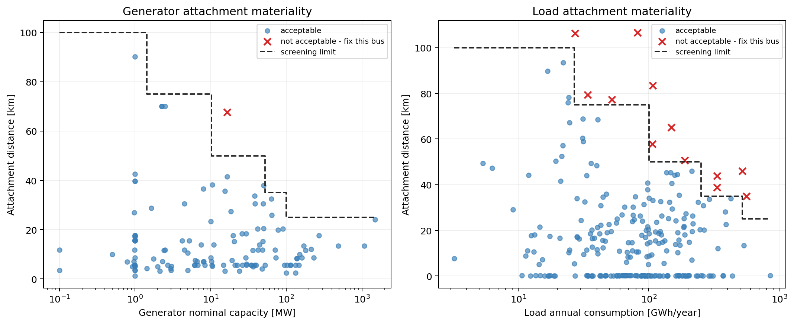

# Phase 05 technical report

## Report metadata

- Phase: 05 - Network repair, topology validation, and unsolved assembly
- Branch: `refactor/v1-phase-05-network`
- Author: Codex, under repository-owner direction
- Reviewer: repository owner; final review pending
- Date: 2026-10-16
- Environment: existing `pypsa-earth-ec` Conda environment
- Heavy execution: no optimization or annual solve was run

## Objective and acceptance criteria

| Acceptance criterion | Status | Evidence |
|---|---|---|
| Topology mutations are deterministic and evidence-linked | Pass with limitations | reviewed repair table and 239-row mutation audit |
| Supported voltage boundary is explicit | Pass | 138/230/500 kV method and tests |
| Buses, branches, transformers, coordinates, and references pass invariants | Pass | `src/topology.py` and Phase 05 tests |
| Connected components and orphans are reported | Pass | 18 true orphans; components of 103, 3, 2, and 2 buses |
| Load and generator attachments are not silent | Pass with review items | 251 load and 133 generator row-level audits plus materiality screens |
| Stage 1 demand and Phase 4 capacity are conserved | Pass | 27,561.62 GWh and 7,489.65 MW |
| Availability profiles attach completely | Pass | 65 hydro and 26 solar/wind profiles |
| Nuclear/future assets remain excluded | Pass | carrier and fleet assertions |
| Candidate network reloads identically | Pass | component/time-series round-trip test |
| Candidate has checksum and provenance | Pass | manifest entry, embedded input hashes, fingerprint |
| Owner accepts the complete phase | Pending | requires report and branch review |

## Topology reconstruction

The supported Stage 04 notebook replaces the current notebook's hidden state with
small reusable functions. The checksum-pinned upstream grid begins with 313
buses, 247 lines, and 62 transformers. Twelve off-standard voltage values are
snapped to declared Ecuador levels, 18 genuinely unreferenced buses are removed,
and the 138/230/500 kV boundary removes 185 additional lower-voltage buses and
their incident components.

The five corridor additions from the legacy notebook are preserved in
`data/interim/network/topology_repairs_2022.csv`. Their evidence is limited to
the repository notebook comments. They are therefore marked as non-official,
low/medium-confidence modeling decisions rather than Master Plan projects.

All 19 retained transformers inherit zero resistance and 0.10 p.u. reactance from
the upstream grid. The legacy numerical repair is made explicit: resistance is
set to 0.01 p.u. and recorded for every transformer in the mutation audit. This
is a modeling assumption requiring future equipment-data improvement.

The resulting topology fingerprint is:

| Item | Value |
|---|---:|
| Snapshots | 8,760 |
| Buses | 110 |
| Lines | 111 |
| Transformers | 19 |
| 138 / 230 / 500 kV buses | 64 / 40 / 6 |
| Connected components | 4 |

The combined map uses the fixed voltage palette established in the owner's
legacy plotting notebook, voltage-scaled line widths, colored bus markers,
provincial boundaries, and neutral dashed transformer connections.



Separate bus-labeled maps make each retained voltage layer inspectable without
masking the lower-capacity corridors:







The main connected component contains 103 buses. The three small components
contain 3, 2, and 2 buses. No unsupported bridge was added; Phase 6 must quantify
their loads, supply, and load shedding during feasibility diagnosis.

## Assembly and spatial aggregation

The legacy assembly first dropped load columns associated with lower-voltage
islands and then remapped other missing bus labels. That silently reduced energy.
The new Stage 05 preserves all 251 Stage 1 source columns. Exact retained bus IDs
stay fixed; other locations are mapped to the nearest retained bus with source
coordinates, target, great-circle distance, method, and rationale written to an
audit table.

Generators use nearest-bus aggregation only when no reviewed physical-connection
evidence exists. Termoesmeraldas I and II now use representative mapped facility
coordinates rather than the former canton proxy. Both are explicitly attached
to bus 42, the 138 kV side of the modeled S/E Esmeraldas group. The co-located
bus 43 is 230 kV and connects through `transf_18_1`; geographic proximity is not
allowed to override the verified voltage. CELEC's technical description states
that Esmeraldas I is stepped from 13.8 kV to the 138 kV SNI connection through
MT1, and the reviewed pre-2022 CELEC / TRANSELECTRIC evidence identifies the
dedicated 138 kV bays. The audit carries location and connection sources.



| Attachment | Count | Mean distance | Maximum distance |
|---|---:|---:|---:|
| Load source columns | 251 | 18.34 km | 106.62 km |
| Existing generators | 133 | 15.14 km | 90.21 km |

Distance is evaluated together with materiality so a 100 km attachment for a
small plant is not treated as equivalent to one for a system-scale plant. The
Phase 5 screening limits are:

| Generator capacity | Acceptable through | Annual load consumption | Acceptable through |
|---|---:|---|---:|
| <= 1 MW | 100 km | <= 25 GWh/year | 100 km |
| > 1-10 MW | 75 km | > 25-100 GWh/year | 75 km |
| > 10-50 MW | 50 km | > 100-250 GWh/year | 50 km |
| > 50-100 MW | 35 km | > 250-500 GWh/year | 35 km |
| > 100 MW | 25 km | > 500 GWh/year | 25 km |

These limits are transparent QA conventions for this reduced-voltage model, not
physical interconnection standards. A row at or below its band limit is
`acceptable`; one above it is `not acceptable - fix this bus`. The classification
does not mutate the network.



The corrected screen flags 1 of 133 generators: Villonaco (16.5 MW, 67.71 km).
Termoesmeraldas I and II now map to the verified 138 kV bus 42 at respectively
2.38 and 2.44 km and pass. The screen flags 12 of 251 load locations,
representing 2,492.96 GWh/year (9.04% of annual demand). The 1 MW Sabiango Solar
attachment at 90.21 km passes its 100 km small-plant screen. Conversely, the
largest 1,500 MW plant is not flagged, demonstrating that the diagnostic does
not hide a high-impact long-distance assignment. Detailed, sortable results are
stored in `generator_attachment_screen_2022.csv` and
`load_attachment_screen_2022.csv`.

The raw distance tail remains visible: `load_179` maps 106.62 km to bus 43. The
report does not reinterpret any nearest-bus choice as physical connection
evidence. Flagged rows require bus-level correction or documented evidence in a
later reviewed change; this Phase 5 analysis deliberately leaves them unchanged.

The assembled candidate contains 133 real generators and 110 emergency
load-shedding generators. Load shedding has a marginal cost of 1,000,000 per MWh
and is a separately labeled feasibility diagnostic, never valid supply. Nuclear
metadata and future capacity are not imported.

## Candidate artifact and provenance

`data/processed/networks/network_base_filled.nc` is an unsolved generated product.
The recorded Phase 5 run has SHA-256
`c33d60526890dc1d19826855ea518767473420d84efbbdd8e21f90895a81eb16`;
the run-specific checksum sidecar is regenerated with the artifact.
It contains 8,760 snapshots, 110 buses, 111 lines, 19 transformers, 251 loads,
and 243 generators. Real nominal capacity is 7,489.65 MW and annual demand is
27,561.62 GWh. Network metadata embeds input checksums and labels the artifact as
unvalidated.

The serialization smoke test reloads the NetCDF and compares component IDs,
structural fingerprint, demand, and generator availability. It is not an
optimization or scientific validation.

## Tests and execution

Executed through the approved environment:

```powershell
python -m src.preflight --stage 04_topology --offline
python -m src.notebook_runner notebooks/04_build_and_validate_2022_topology.ipynb --timeout 600
python -m src.preflight --stage 05_assembly --offline
python -m src.notebook_runner notebooks/05_assemble_and_smoke_test_2022_network.ipynb --timeout 600
python -m unittest discover -s tests -v
```

The tests cover voltage snapping, repair evidence, orphan handling, boundary and
topology invariants, structural fingerprint, connected components, attachment
coverage and materiality screening, demand and capacity conservation, profile coverage, nuclear exclusion,
load-shedding separation, notebook contracts, and NetCDF round-trip identity.

The approved environment continued to emit non-failing GDAL/ecCodes discovery
warnings during PyPSA/xarray imports. No package was installed or changed.

Not run:

- no optimization, power flow, short solve, or full-year solve;
- no calibration or change made to improve agreement with official statistics;
- no annual energy balance or carrier comparison; and
- no Master Plan or future-scenario processing.

## Limitations and Phase 6 handoff

- The five corridor repairs have notebook evidence only and must not be presented
  as official grid facts.
- Transformer resistance is a uniform numerical assumption, not nameplate data.
- Four connected components remain and require explicit feasibility accounting.
- The materiality screen marks 12 load and 1 generator attachment as
  `not acceptable - fix this bus`; they remain unchanged pending substation or
  connection evidence.
- Carrier costs retain incomplete legacy provenance and are calibration inputs
  only if Phase 6 documents a source-supported decision.
- Emergency generators make infeasibility measurable; any material dispatch is a
  model defect/limitation to report, not ordinary generation.

## Conclusion

Phase 05 is implementation-complete and ready for owner review. It produces a
deterministic, source-linked, reloadable unsolved Ecuador 2022 candidate while
making the inherited topology and attachment assumptions visible. The project
still does **not** have a validated 2022 network. That claim requires the Phase 6
solve, energy balance, carrier-by-carrier 5% gate, calibration record, and result
provenance.
