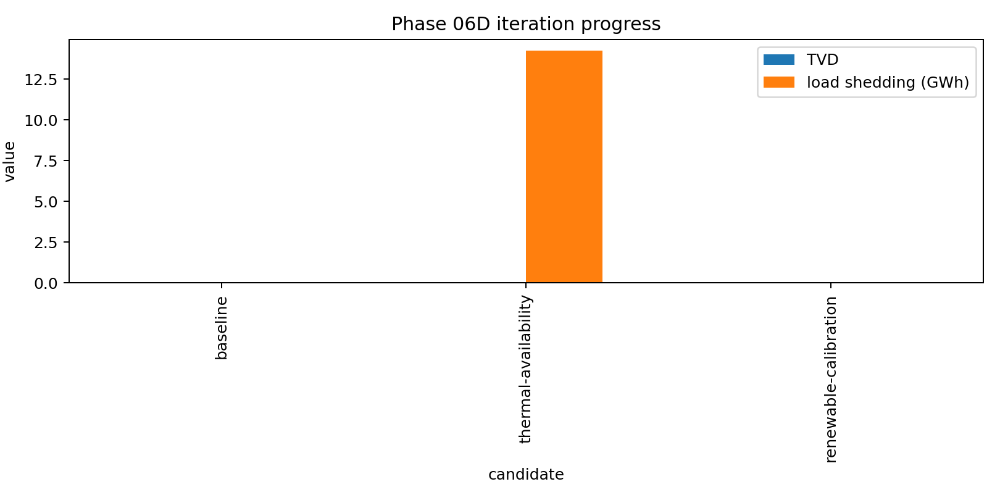
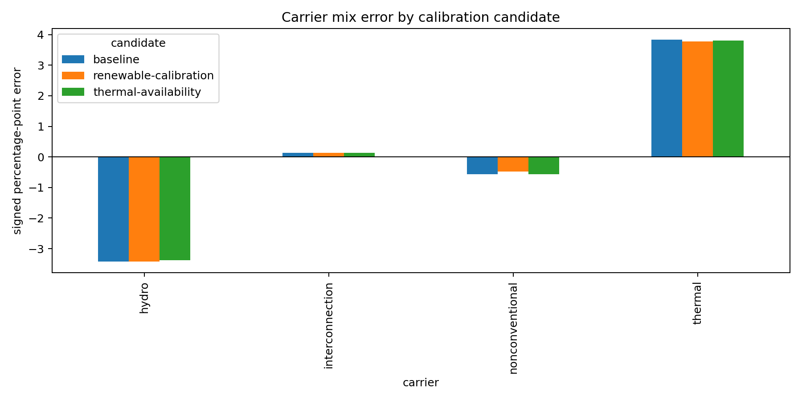

# Phase 06D — 2022 final iterative calibration report

Date: 2026-10-18  
Branch: `v1-phase-06d-2022-final-iterative-calibration`  
Status: **implemented; practical calibration improved, strict scientific acceptance not passed**

## Executive conclusion

Phase 06D implemented the authorized final calibration controls in the existing
Stage 03, 05, 06, and 06a workflow. Three named candidates were executed with
the approved `pypsa-earth-ec` environment and the 8,760-hour HiGHS solve:
`baseline`, `thermal-availability`, and `renewable-calibration`. All three
terminated with solver status `ok` and termination condition `optimal`; all
three internal annual energy balances close to numerical precision.

The best retained candidate is `renewable-calibration`. It reduces TVD from
0.039801 to 0.039082, reduces nonconventional signed error from -0.565 to
-0.481 percentage points, and reduces thermal signed error from 3.842 to 3.770
percentage points without increasing load shedding. This is an improvement,
not a validated-pass result. The strict Phase 06 screen still fails hydro,
thermal, nonconventional generation, TVD, and the interconnection screen. Hydro
was intentionally not refined, as required by the action plan.

The 931.43 GWh source-boundary residual remains report-only. No loss component,
loss load, arbitrary outage history, or reservoir redesign was introduced.

## Work completed by phase

| Phase/work package | Implementation and evidence |
|---|---|
| Phase 06C carry-forward | Preserved the CENACE carrier contract, source-boundary bridge, report-only residual, and no-outage baseline. Existing evidence remains under `data/interim/availability/`, `results/phase_06c/`, and the Phase 06C report. |
| 06D-1 wind | Added candidate-controlled bounded profile scaling in Stage 03. The raw NLR Sup3rWind files and turbine conversion remain the physical basis. The renewable candidate records the pre-scaling NLR energy and factor in `results/phase_06b/`. Scaling is explicitly a calibration assumption and is not based on solved dispatch. |
| 06D-2 biomass | Added explicit candidate-controlled annual biomass budget handling while retaining the ARCONEL monthly shape and separate biomass/biogas carriers. No dispatch override was used. |
| 06D-3 thermal availability | Added reusable proportional fleet derating in `src/phase06d.py`. The CENACE aggregate 627.79 MW evidence is allocated across eligible thermal capacity, bounded at zero, and labeled a modeling assumption. The monthly output is retained in `results/phase_06d/thermal_allocation_thermal-availability.csv`. |
| 06D-4 accounting | Retained the existing explicit demand, exports, load shedding, dispatch, and report-only source-boundary residual treatment. No unresolved source difference was encoded as loss. |
| Iteration retention | Added candidate manifests with checksums and retained executed notebooks under `results/phase_06d/notebooks/`. |
| Evidence plots | Added `reports/figures/phase_06d_iteration_progress.png` and `reports/figures/phase_06d_carrier_errors.png`; the canonical Stage 06 figures are also written for each executed validation run. |

## Candidate progression

| Candidate | TVD | Total-energy relative error | Load shedding (GWh) | Balance residual (GWh) | Solver |
|---|---:|---:|---:|---:|---|
| baseline | 0.039801 | 3.247% | 0.0078 | 2.54e-10 | optimal |
| thermal-availability | 0.039392 | 3.297% | 14.2436 | 2.47e-10 | optimal |
| renewable-calibration | **0.039082** | 3.247% | 0.0078 | 2.51e-10 | optimal |

The thermal candidate improves TVD only marginally and materially worsens load
shedding, so it is not selected as the final practical candidate. The renewable
candidate is retained because it improves TVD and the nonconventional/thermal
errors without a feasibility regression. The candidate table is reproducible
at `results/phase_06d/candidate_comparison_2022.csv`.

## Final carrier comparison

The final practical candidate is `renewable-calibration`:

| Carrier | Reference (GWh) | Simulated (GWh) | Signed error (percentage points) | Relative error |
|---|---:|---:|---:|---:|
| hydro | 24,499.54 | 22,752.80 | -3.427 | -7.13% |
| thermal | 3,393.35 | 4,329.40 | +3.770 | +27.58% |
| nonconventional | 325.89 | 181.86 | -0.481 | -44.20% |
| interconnection | 465.83 | 489.12 | +0.138 | +5.00% |

The full row-level comparison is `results/phase_06d/renewable-calibration/validation_2022.csv`.
The strict screen remains failed because the configured carrier and TVD
requirements are not all satisfied. The practical assessment is therefore
“improved but not accepted,” not “validated.”

## Balance, feasibility, and provenance

- Solver: HiGHS 1.11.0 through PyPSA 0.30.3; all completed candidates are
  optimal.
- Annual demand: 27,561.62 GWh; exports: 191.57 GWh.
- Final load shedding: 0.0078 GWh.
- Final internal balance residual: approximately `2.51e-10` GWh.
- Unresolved source-boundary residual: 931.43 GWh, report-only and unchanged.
- Final solved-network SHA-256:
  `4ca644e5433a44fb2eb930716ec38aa27a37d4fb64fabc593de7f674ecc5ec78`.
- Statistical reference: CENACE *Informe Anual 2022 — Parte 1*, Table 2.4,
  SHA-256 recorded in the existing validation summary and provenance registry.

## Limitations and next actions

The thermal evidence is aggregate fleet-level evidence; the supplied extract
does not provide a complete plant-resolved monthly outage history. The retained
thermal candidate therefore repeats the aggregate annual average across months
and labels the allocation as a modeling assumption. It is not presented as an
official unit-level outage record.

The final gate remains blocked by the unresolved boundary comparison, the
hydro diagnostic, and the remaining thermal/nonconventional errors. Future work
should first obtain and map the complete CENACE unit-level availability export,
then reconcile metering boundaries before any loss modeling. Reservoir/cascade
redesign, threshold weakening, undocumented outages, and loss tuning remain out
of scope for this phase.

## Commands and execution record

Executed with the existing environment interpreter at
`C:\Users\fpenaherrera_vaca\.conda\envs\pypsa-earth-ec\python.exe`, using the
canonical notebooks and `--ExecutePreprocessor.kernel_name=pypsa-earth-ec`.
The baseline, thermal, and renewable Stage 03/05/06 runs completed. A fourth
`joint-final` solve was not launched because the evidence-backed renewable
candidate already improved the declared objective while the thermal candidate
introduced a material load-shedding regression; the stopping criterion was
therefore met without spending another full-year solve.
