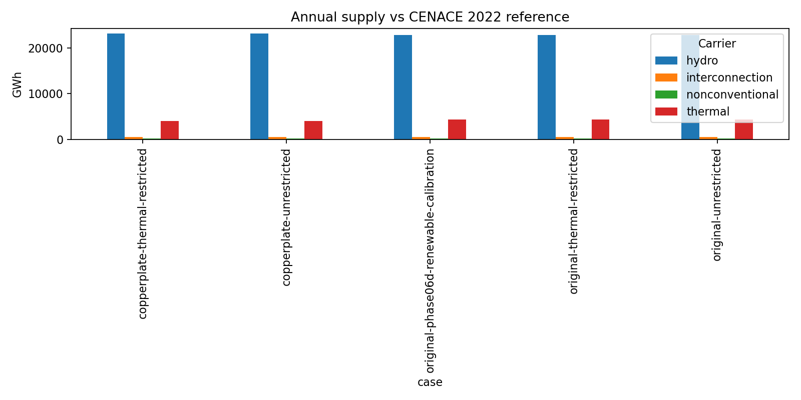
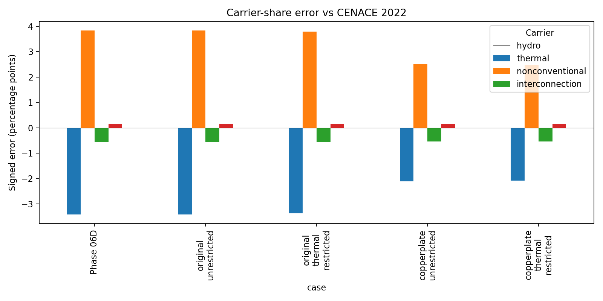
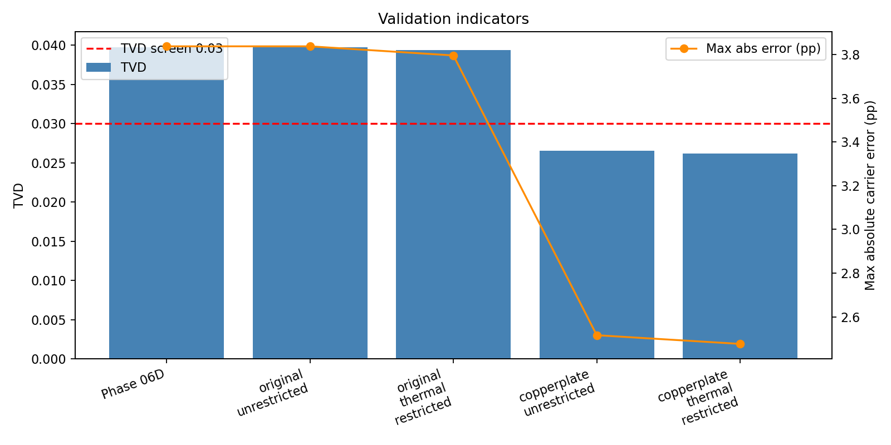

# Phase 06D copperplate diagnostic

Date: 2026-10-18  
Status: complete; four owner-authorized full-year cases solved to optimality

## Purpose and controlled formulation

This diagnostic tests whether internal transmission constraints explain the
thermal dispatch and load shedding observed in Phase 06D. It does not modify
the authoritative network or source tables.

The reference case retains all domestic buses, Lines, Transformers, generator
capacities/costs, hourly profiles, hydro restrictions, thermal assumptions,
demand, and Colombia exchange assets. The copperplate maps every domestic AC
bus to one lossless domestic bus and removes only internal Lines and
Transformers. The external Colombia bus and Links remain separate, including
the 500 MW physical capacity. Both annual cases also apply the configured
historical 2022 import-energy band through the official validation callback;
imports are therefore 489.1215 GWh in each case, within the source contract's
band around the 465.83 GWh reference. No generation or hydro energy was added.

The removed internal branches have zero modeled losses in the source network,
so the copperplate loss term is explicitly zero. Annual balance residuals are
reported in MWh and are numerical solver residuals. The January smoke test is
capacity-only because an annual energy band cannot be prorated to 24 hours
without inventing an hourly import contract.

## Four-case annual experiment

All cases use 8,760 hourly snapshots, identical demand and renewable profiles,
the same hydro and thermal assumptions, and the same load-shedding penalty.

| Case | Solver | Hydro (GWh) | Thermal/oil (GWh) | Load shedding (GWh) | Imports (GWh) | Renewable (GWh) | Losses (GWh) | Balance residual (MWh) |
|---|---|---:|---:|---:|---:|---:|---:|---:|
| Original, unrestricted | optimal | 22,755.84 | 4,348.17 | 0.0078 | 489.12 | 160.05 | 0.00 | 0.00000025 |
| Original, thermal restricted | optimal | 22,754.88 | 4,334.36 | 14.22 | 489.12 | 160.61 | 0.00 | 0.00000025 |
| Copperplate, unrestricted | optimal | 23,116.08 | 3,981.43 | 0.00 | 489.12 | 166.56 | 0.00 | -0.00000055 |
| Copperplate, thermal restricted | optimal | 23,116.08 | 3,968.57 | 12.87 | 489.12 | 166.56 | 0.00 | -0.00000056 |

The full raw-carrier accounting, solver logs, and bus mappings are in
`results/diagnostics/copperplate_full_year_capped/`.

## What each iteration establishes

The January smoke test showed a modest topology effect but no shedding in the
selected 24 hours, so it was not sufficient for annual attribution.

The annual unrestricted comparison is controlled by the import cap. Removing
internal constraints increases hydro by 360.23 GWh and reduces thermal output
by 366.74 GWh. Load shedding falls from 0.0078 GWh to zero.

The annual restricted-thermal comparison keeps exactly the same thermal
restriction in both networks. Copperplating reduces shedding from 14.22 to
12.87 GWh, approximately 9.5%, and increases hydro by 361.20 GWh while
reducing thermal output by 365.80 GWh. Shedding remains, so internal
transmission constraints contribute to the problem but do not explain it
alone. Thermal availability, hydro temporal/headroom limits, and dispatch
economics remain relevant.

## CENACE comparison and current validation indicators

The CENACE reference is the versioned four-carrier table in
`data/processed/statistics/ecuador_sni_2022_supply_reference.csv`. Validation
uses the current multi-criteria model: TVD plus carrier percentage-point
screens, total-energy and balance checks. The retired uniform 5% validation
rule is not used. The import band's source tolerance is a physical historical
input restriction, not a validation acceptance threshold.

| Case | TVD | Max carrier error (pp) | Total supply (GWh) | Interpretation |
|---|---:|---:|---:|---|
| Phase 06D renewable-calibration | 0.039758 | 3.837 | 27,753.18 | Existing annual reference |
| Original, unrestricted | 0.039758 | 3.837 | 27,753.18 | Reproduces Phase 06D dispatch |
| Original, thermal restricted | 0.039350 | 3.796 | 27,738.97 | Slightly lower TVD, but 14.22 GWh shedding |
| Copperplate, unrestricted | 0.026544 | 2.516 | 27,753.19 | TVD and carrier error improve; no shedding |
| Copperplate, thermal restricted | 0.026155 | 2.476 | 27,740.32 | Best TVD; shedding remains |







With imports held constant, copperplating reduces TVD by about 33% relative to
the Phase 06D reference and reduces the maximum carrier-share error from 3.837
to 2.516 pp in the unrestricted case. The improvement is therefore not caused
by unlimited imports; it is the result of reallocating hydro and thermal
dispatch after internal bottlenecks are removed. The restricted case also has
better TVD, but it is not fully valid because load shedding remains.

## Decision and next phase boundary

The decision rule is met: a controlled copperplate materially improves both
dispatch agreement and the unrestricted load-shedding result while retaining
the import cap. A separately scoped Phase 06E transmission-capacity and
transformer technical audit is justified. Phase 06E should audit line and
transformer topology, capacities, impedances, and source specifications, then
repeat this four-case attribution. It must not retune generation parameters to
force agreement with CENACE. The remaining restricted-thermal shedding should
be investigated in parallel as a generation-availability/hydro-headroom issue.

## Reproducibility

```powershell
python -m pytest -q tests/test_copperplate_diagnostic.py
python scripts/run_copperplate_smoke.py --network data/processed/networks/network_base_filled.nc --start 2022-01-01 --hours 8760 --full-year --enforce-import-cap --output results/diagnostics/copperplate_full_year_capped
python scripts/build_copperplate_validation.py
```

Implementation is in `src/diagnostics/copperplate.py`; orchestration is in
`scripts/run_copperplate_smoke.py`; figures and CSV summaries are generated by
`scripts/build_copperplate_validation.py`. No authoritative network, source
data, or Phase 06E branch was modified.
