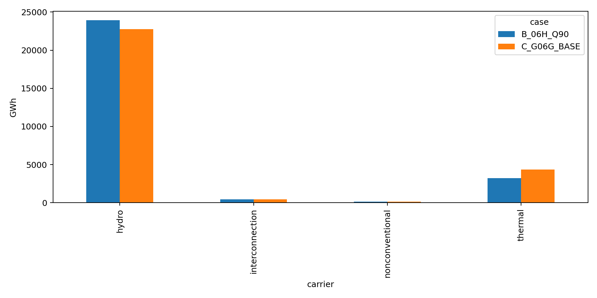
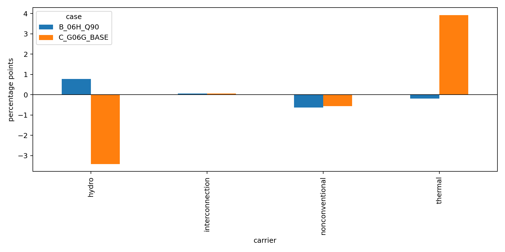

# Phase 06H — Final calibration report

## Executive result

The canonical Stage 00→06a workflow was executed on branch `v1-pahe-06h-consolidation` from 06G commit `f1a9e871d4df04f08124d763e41f7a3d90fdbd2d`. The full 8,760-hour HiGHS solve completed with status `ok` and termination `optimal`. The result is a **provisionally calibrated 2022 baseline**, not an independently validated historical physical network.

The direct upstream hydro change reproduces the Phase 06G ROR-Q90 composition result: TVD **0.00830452**, versus **0.03980131** for the matched pre-Q90 formulation. Q90 passes the configured TVD, hydro, thermal and interconnection screens, but fails the nonconventional share screen: **−0.637 pp** versus the **0.5 pp** limit. Therefore the scientific acceptance status remains **FAIL/PARTIAL**, while Q90 is the preferred research baseline for scenario exploration.

## What was retained

The 06A/06B source-supported La Concordia–Pedernales, Minas San Francisco–La Unión–San Ildefonso and Chongón–Santa Elena connectivity repairs remain in the canonical topology. The 06E capacity-audit registry remains unused because it did not establish source-defensible ratings. The 06D aggregate thermal derating is not applied. Imports remain constrained to 465.83 GWh and Colombia/Peru exports remain fixed sinks totaling 191.57 GWh.

Stage 03 now uses the exact 06G ROR method directly: each assigned monthly flow series is divided by its empirical 0.90 quantile and clipped to [0,1]. Reservoirs retain trailing-three-month smoothing and the original 0.95 quantile. This is a modeling normalization of monthly magnitudes, not observed rated flow and not hydrological Q90 exceedance. NLR Sup3rWind 2022 site CSVs are required for both wind plants; the legacy `onwind.nc` fallback and renewable candidate switch are removed from the active path. ARCONEL monthly biomass shape and the 195.68 GWh annual control are retained, explicitly as calibration input rather than independent validation.

## Comparable carrier results

The machine-readable carrier table is [comparison_carriers.csv](../results/phase_06h/comparison_carriers.csv). C is the matched historical Phase 06G BASE control; B is the freshly rebuilt canonical Q90 baseline. A is shown as the retained original-06 evidence identity; it is numerically represented by the same pre-Q90 historical control, not claimed as a fresh rerun of the old branch.

| Case | Hydro GWh | Thermal GWh | Nonconventional GWh | Imports GWh | Exports GWh | TVD | Shedding GWh | Solver |
|---|---:|---:|---:|---:|---:|---:|---:|---|
| A original Phase 06 evidence / pre-Q90 | 22,756.12 | 4,372.65 | 158.58 | 465.83 | 191.57 | 0.03980 | 0.00782 | historical optimal |
| C matched G06G_BASE | 22,756.12 | 4,372.65 | 158.58 | 465.83 | 191.57 | 0.03980 | 0.00782 | optimal |
| B fresh 06H ROR-Q90 | 23,919.36 | 3,229.49 | 138.51 | 465.83 | 191.57 | **0.00830** | **0.00000** | optimal |

For B, total comparable supply is 27,753.19 GWh versus 28,684.61 GWh in the reference table, a 3.247% boundary difference. The numerical network balance residual is 2.5×10⁻¹⁰ GWh. The 931.43 GWh CENACE statistical boundary residual is not modeled as losses. No physical network-loss series is represented in this result.

Relative to the reference mix, B has hydro −580.18 GWh / +0.776 pp, thermal −163.86 GWh / −0.193 pp, nonconventional −187.38 GWh / −0.637 pp, and interconnection approximately 0 GWh / +0.055 pp. The sum of absolute share errors is 1.662 pp; TVD is half of that, 0.830 percentage points.

## Figures

The plots show the key scientific trade-off: Q90 moves hydro toward the reference and reduces thermal overproduction, but it does not solve the independently unresolved nonconventional deficit. The improvement is therefore a composition-fit sensitivity, not proof that the underlying proxy flows equal plant hydrology.

## Registries, provenance and executed evidence

The canonical execution copies are in `results/phase_06h/notebooks/`, covering notebooks 00, 01, 02, 03, 04, 05, 06 and 06a. The solved network is `results/phase_06/network_solved_2022.nc`; its artifact metadata is in `results/phase_06/artifacts.json`. Stage 03 product fingerprints were updated in `config/artifacts.yaml` after deterministic regeneration. The active workflow no longer selects `baseline`, `renewable-calibration`, or `thermal-availability` candidates.

The retained limitations are material: eight legacy monthly hydro series have unverified primary origin; 65 plants use 4 direct, 5 same-system and 56 low-confidence regional proxy assignments; Q90 is model-tuned; wind uses simplified curves and may contain calibration leakage in its historical source selection; biomass potential and dispatch differ; plant-hour thermal outage data are unavailable; historical line/transformer ratings remain unresolved; and the 931.43 GWh accounting boundary remains open.

## Recommendation and Stage 07 handoff

Adopt **ROR-Q90** as the single provisional research baseline for exploratory Stage 07 scenarios, with the qualification that it is source-constrained and composition-improved, not independently validated. Do not present the baseline as passing the historical acceptance gate. Future work requiring a validated historical claim needs primary plant-level hydro observations/rated flows, plant-hour thermal availability, and a resolved CENACE metering boundary; further percentile tuning alone should not be treated as evidence.

## Final addendum — diagnostic figures, pipeline, and Phase 07 decision

The final 06a diagnostic was converted from a minimal dispatch summary into a read-only, full-year diagnostic interface. It verifies the canonical solved artifact and SHA-256, requires all 8,760 hourly 2022 snapshots, never falls back to the unsolved network, never calls a solver, displays figures inline in the executed notebook, and saves 300-DPI PNG plus SVG copies. A machine-readable figure manifest and concise diagnostic CSVs are written under results/phase_06a/.

The geographic figures retain the Notebook 04 Ecuador cartographic identity: mainland GADM provinces, excluded Galápagos, fixed 138/230/500 kV colors, equal geographic aspect, and existing network coordinates. The maps include annual demand bubbles, annual dispatched domestic generation bubbles, installed domestic capacity bubbles, and net nodal energy balance. Demand uses log1p(GWh) bubble-area scaling; dispatch and capacity use log-scaled bubble areas; dominant technologies provide stable colors. Imports and load shedding are excluded from domestic generation and capacity maps.

Hydro classification is joined from the processed fleet inventory, distinguishing 60 run-of-river Pasada plants and 5 reservoir Embalse plants. Diagnostic labels use ex_COL for the Colombian interface while preserving the canonical interconnection_colombia network carrier and validation taxonomy.

The energy-boundary figure was corrected to calculate imports from the solved interconnection_colombia generator and exports from the two solved export loads. Verified values are 465.83 GWh imports, 159.15 GWh Colombia exports, and 32.42 GWh Peru exports, totaling 191.57 GWh. Numeric labels are included because these flows are much smaller than domestic generation and demand.

The implemented diagnostic pipeline loads results/phase_06/network_solved_2022.nc; verifies identity, snapshots, and calendar; reads PyPSA dispatch, availability, loads, buses, lines, generators, and weights without mutation; applies the authoritative validation mapping; excludes artificial supply from domestic maps; calculates weighted annual/monthly GWh, shares, capacity factors, hydro offers, demand, imports, exports, and balance residuals; then generates the figures, inline displays, manifest, and derived tables. The executed notebook is results/phase_06h/notebooks/06a_diagnose_2022_validation.executed.ipynb and the reusable implementation is src/diagnostics_06a.py. The solved-network checksum remained unchanged and no optimization was executed during diagnostic revisions.

### Phase 07 readiness

**Ready with qualification:** the project is ready for an illustrative Phase 07 expansion notebook, not for claims of independently validated historical forecasting.

Phase 07 may demonstrate a small complete workflow that forecasts demand under explicit assumptions, adds illustrative generation and transmission expansions, compares an unchanged 2022 reference topology with an expansion case, and visualizes investment, dispatch, congestion, imports/exports, and adequacy. The example must remain pedagogical and scenario-based: it must not silently recalibrate 2022, treat ROR-Q90 as observed hydrology, convert the 931.43 GWh statistical residual into losses, or present future additions as official Master Plan facts without source traceability. The nonconventional share gate remains failed, so Phase 07 must visibly label the starting point as a provisionally calibrated baseline and keep future assumptions separate from historical validation evidence.

