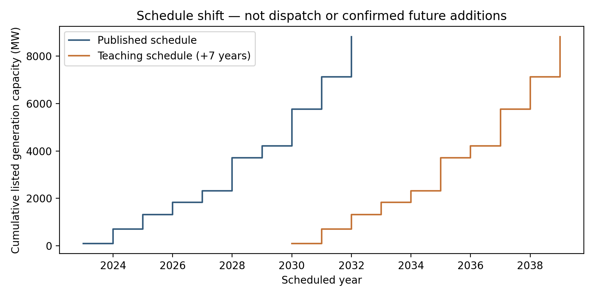
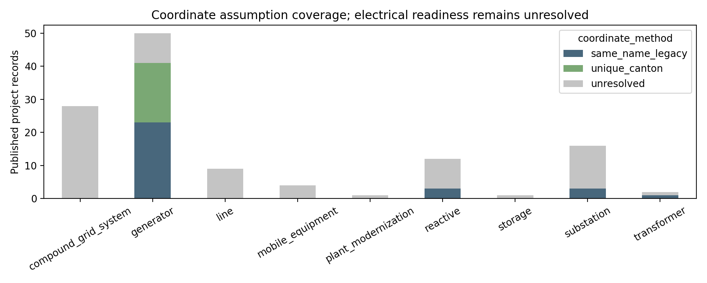

# Phase 07 — Master Plan expansion inventory and teaching schedule

## Report record

- Report date: 2026-10-20
- Branch: `refactor/v1-phase-07-master-plan`; uncommitted working-tree delivery
- Starting revision: `1cdf2788043619dbf2c779a6435ca2b82cb23adc`
- Executed artifacts: `results/phase_07/`
- Source: owner-supplied *Anexos ajuste PME 2023-2032* (`AJUSTE-PME-2026.pdf`)
- Environment: existing Conda environment `pypsa-earth-ec`, Python 3.11.14,
  pandas 2.3.3, PyPSA 0.30.3
- Agents: `research` (source review), `developer` (implementation),
  `scientific_reviewer` (read-only review), `documentation` (reporting)
- Solver: not invoked; no network was built or mutated

## Outcome and scope

Phase 07's source inventory and configurable delayed teaching schedule are
implemented and reproduced. The owner selected the latest adjustment as the
planning reference, confirmed the earlier chapters 3–5 are 2017-origin legacy
material, and directed that missing physical values be defined later as
teaching assumptions. The default exercise delay is seven years.

This closes the source-inventory and schedule deliverables. It does not pass the
physical model-readiness gate: every adjustment row remains `model_ready=False`
until missing electrical facts or later explicit teaching assumptions are
provided. No network-use claim, scenario result, or Ecuador 2022 validation
claim follows from this phase.

## Source and methods

The four-page PDF is titled *Anexos ajuste PME 2023-2032*. Its registered local
copy is [`literature/PlanMaestroElectrifEc/AJUSTE-PME-2026.pdf`](../literature/PlanMaestroElectrifEc/AJUSTE-PME-2026.pdf),
SHA-256 `3f131642a88e1923461529591d2ff5cc8417149b0a271b0bf19074c1f984c3e0`.
The [Ministry's source PDF](https://www.ambienteyenergia.gob.ec/wp-content/uploads/2026/06/Anexos-A-B-y-C_ajuste_pme_20260611.pdf)
is the persistent source URI. The schedule is published planning evidence;
financing in management does not confirm construction or commissioning.

Research visually checked Annex A on pages 1–2, Annex B on page 3 and Annex C
on page 4. Their transcription tables are
[`adjustment_2026_generation.csv`](../data/raw/planning/adjustment_2026_generation.csv),
[`adjustment_2026_grid_projects.csv`](../data/raw/planning/adjustment_2026_grid_projects.csv),
and [`adjustment_2026_totals.csv`](../data/raw/planning/adjustment_2026_totals.csv).
Each normalized project retains source edition, page/annex, original text and
source checksum in [`projects.csv`](../data/processed/planning/projects.csv).
The source inventory and exercise settings are summarized in
[`portfolio_manifest.json`](../data/processed/planning/portfolio_manifest.json).

The transcription records source timing separately from the teaching date:

\[
  y_{exercise} = y_{published} + d, \qquad d=7\text{ years by default}.
\]

The default is pinned in [`config/planning.yaml`](../config/planning.yaml);
another delay can be passed to `build_products(delay_years=...)`. Source dates
remain unchanged, half-year timing is retained, and each repeated item receives
an explicit `EX_REPEAT_*` scenario identifier. The exercise dates span
2030–2039. This is a configurable classroom repeat, not a forecast or evidence
that projects remain unbuilt.

Coordinates use exact-name legacy matches or unique canton matches only. Such
coordinates are assumptions with low confidence. No nearest-bus repair or
electrical connection is inferred. Potential overlaps B039/B045
(Ibarra–Pimampiro), B052/B055 (Shushufindi–Orellana), and B026/B031
(Portoviejo) remain unresolved and are listed in
[`project_relationships.csv`](../data/processed/planning/project_relationships.csv).

## Verified results

| Evidence | Result | Trace |
|---|---:|---|
| Rows in Annex A / B / C | 50 / 59 / 14; 123 total | PDF pages 1–4; `projects.csv`; `portfolio_manifest.json` |
| Direct asset views | 50 generators, 9 lines, 16 substations, 2 transformers | `generation.csv`, `lines.csv`, `substations.csv`, `transformers.csv` |
| Other project categories retained in full inventory | 28 compound grid systems, 12 reactive, 4 mobile equipment, 1 modernization, 1 storage | `projects.csv` |
| Generation capacity row sum | 8,818.75 MW; printed total 8,818.75 MW | `adjustment_2026_generation.csv`, `adjustment_2026_totals.csv`, `source_total_reconciliation.csv` |
| Mean generation row sum vs printed total | 48,759.01 vs 47,413 GWh/year; difference 1,346.01 GWh/year | same source tables; `source_total_reconciliation.csv` |
| Coordinate coverage | 48 assigned, 75 unresolved | `coordinate_coverage.csv` |
| Model-ready records | 0 of 123 | `exercise_schedule.csv`, `portfolio_manifest.json`, `exercise_readiness_issues.csv` |

The mean-energy discrepancy is retained without explanation or correction. It
must not be substituted into dispatch or control data. The four direct asset
views are a subset of the 123-row project inventory; the remaining 46 compound
or non-direct categories stay in `projects.csv`. No decomposition is inferred.

The source check `generation_source_checks.csv` also flags Tugaduaja 2 - Fase 2
(A049): its listed 2,058 GWh/year exceeds 150 MW multiplied by 8,760 hours
(1,314 GWh). Both published quantities remain unchanged. This is a source
consistency warning, not a dispatch result or a correction to the PDF.

The 2017-origin chapters remain separate legacy evidence. Their older extracts
are preserved as 187 unverified candidate records and 11 quarantined nuclear
records under `data/interim/planning/`. They are not relabeled or merged into
the adjustment. Nuclear remains outside official planning products.

## Acceptance and checks

| Phase 07 item | Status |
|---|---|
| Identify and checksum the owner-selected adjustment | PASS |
| Transcribe all reviewed Annex A/B/C rows with source lineage | PASS |
| Preserve source dates and produce configurable seven-year exercise schedule | PASS |
| Preserve non-direct project categories and legacy evidence | PASS |
| Record totals, coordinate coverage and unresolved relationships | PASS |
| Physical/electrical readiness for network use | DEFERRED; 0/123 rows model-ready |
| Ecuador 2022 baseline validation or future network solve | NOT ESTABLISHED / NOT RUN |

Executed in the approved environment:

```powershell
conda activate pypsa-earth-ec
python -m src.preflight --stage 07_planning --offline
python -m scripts.migrate_phase07_planning
python -m unittest discover -s tests -p 'test_phase07*.py' -v
python -m src.notebook_runner notebooks/07_prepare_master_plan_expansion.ipynb --output results/phase_07/07_prepare_master_plan_expansion.executed.ipynb
```

Preflight verified the cached PDF against its registered size and SHA-256.
The 37 Phase 07 tests passed; their log is
[`phase07_tests.log`](../results/phase_07/phase07_tests.log). The notebook run
is retained at
[`07_prepare_master_plan_expansion.executed.ipynb`](../results/phase_07/07_prepare_master_plan_expansion.executed.ipynb).
The notebook saves `published_vs_delayed_generation.png` and
`coordinate_coverage.png` under `reports/figures/phase_07/`; these show
transcription and coordinate evidence, not network outcomes.





Two broader inherited suites still have failures outside the new Phase 07
checks: the artifact suite has one environment-spec test failure because the
existing environment specification omits Plotly, and the repository-contract
suite has four pre-existing inventory/module/path failures. Logs are
[`artifact_tests.log`](../results/phase_07/artifact_tests.log) and
[`repository_contract_tests.log`](../results/phase_07/repository_contract_tests.log).
No environment changes were made to mask them. No package was installed, no
large download was initiated in this run, and no annual solve or scenario batch
was run. The full-year solve remains a manual scientific validation run.

The 17-input Stage 07 preflight passed. Two pre-existing lookup fingerprints
were stale; their byte sizes and SHA-256 were reconciled only after confirming
that their Git blob hashes matched HEAD and the working files were unchanged.
The student notebook uses the tracked transcriptions and needs no PDF parser.
Source inspection used the already installed PDF.js reader and Windows PDF
renderer; all four source pages and both generated figures were visually checked.
`git diff --check` passed, and no new tracked-file inventory issues were added.

## Remaining scientific work

The owner-approved boundary is to define missing physical values later as
explicit teaching assumptions. Before any future network transformation,
record those assumptions separately from source facts, identify their effect on
each asset, resolve the three potential project relationships, and provide
reviewed electrical connections and parameters. Until then, the strict
model-readiness query must continue to reject all 123 projects. The 1,346.01
GWh/year printed-versus-row-sum discrepancy also remains an unresolved source
question for scientific review.
