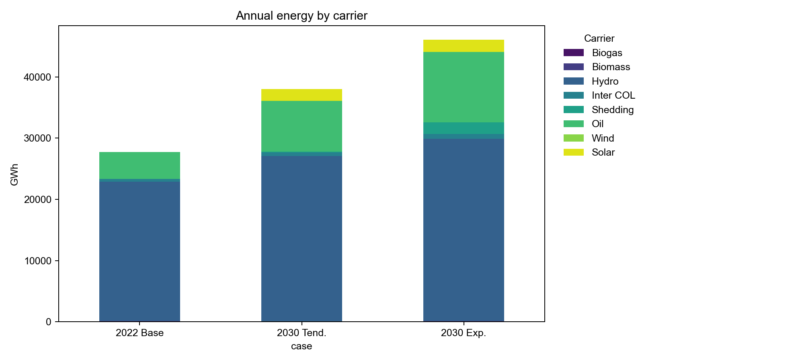
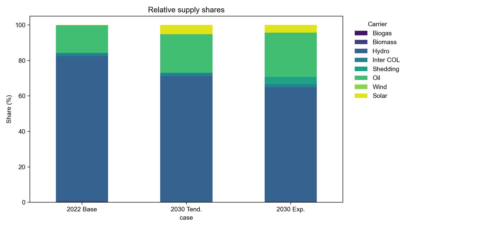
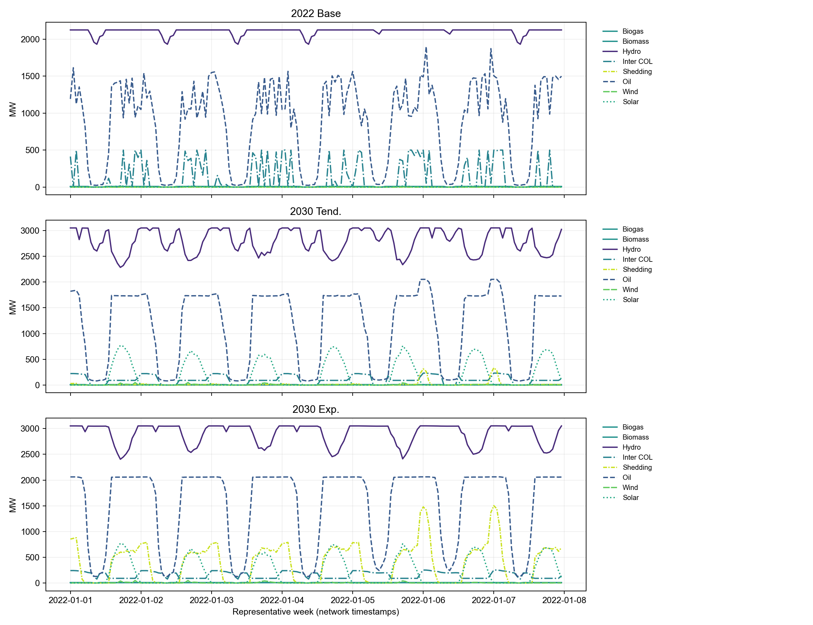

# Phase 08 — Minimal 2030 Master Plan screening

## Outcome

The experiment was run in the approved `pypsa-earth-ec` environment on the
full 8,760-hour 2022 network. Both HiGHS optimizations terminated `optimal`.
Solved networks and solver logs are in [`results/phase_08`](../results/phase_08/).

This is deliberately a screening experiment, not a model-ready Master Plan
network. Phase 07 found that official future projects still lack reviewed
electrical connections and parameters. The experiment therefore adds the
published 2023–2030 renewable capacity as three aggregate generators at proxy
bus 84, while retaining the 2022 topology and existing fleet.

## Cases and assumptions

The 2030 demand forecasts are the existing planning table values: 38,042 GWh
(`Tendencial`) and 46,084 GWh (`Expansion`). Each scales the 2022 hourly and
spatial demand shape uniformly. Renewable additions from the Phase 07 planning
table total 3,666.55 MW: hydro, photovoltaic and wind rows only. Nuclear and
future thermal rows are excluded.

Colombia imports are capped at 450 MW in aggregate. The historical 2022 annual
import-energy band is not imposed on the future cases. This follows the
operator-supported interconnection ceiling supplied by the owner; actual
imports can be below the ceiling.

## Results

The baseline comparator is the completed Phase 06d 2022 solved network. The
comparison tables are in `results/phase_08/base_vs_2030_metrics.csv`,
`base_vs_2030_carrier_energy.csv`, and `base_vs_2030_carrier_shares.csv`.

| Indicator | Tendencial 2030 | Expansion 2030 |
|---|---:|---:|
| Demand (GWh) | 38,042 | 46,084 |
| Planned renewable additions (MW) | 3,666.55 | 3,666.55 |
| Colombia imports (GWh) | 604.43 | 762.62 |
| Load shedding (GWh) | 124.99 | 1,894.79 |
| Load shedding (% demand) | 0.329% | 4.112% |
| Solver termination | optimal | optimal |

The reported 2022 capacity is not sufficient for either 2030 demand case in
this screening configuration: both cases shed load. The Expansion case is
materially worse, with 15.2 times the Tendencial shedding. Imports increase but
the 450 MW ceiling does not remove the deficit. The result is a warning about
future adequacy, not proof that the published generation portfolio itself is
inadequate, because the grid expansion and project-specific connections are
not represented.

## Profiles, mix and technical interpretation

The representative-week dispatch trace is saved as
`reports/figures/phase_08/phase08_representative_week_dispatch.png`. It shows
the chronological dispatch stack for 7–13 January in the network timestamps,
including imports and load shedding. The adequacy totals come from all 8,760
hours, not from this illustrative week.

Figure convention: the report figure uses explicit line traces for the first
168 actual network snapshots, not a stacked area chart. Case labels are `2022
Base`, `2030 Tend.` and `2030 Exp.`. Legend labels are shortened to `Inter COL`
and `Shedding`, with Hydro, Oil, Solar and Wind shown separately.

All report figures use the perceptually ordered viridis scientific palette.
Trace styles also encode the carrier: solid Hydro, dashed Oil, dash-dot Inter
COL, dotted Solar, long-dashed Wind, and a dash-dot-dot Shedding line. This
keeps the comparison readable in grayscale or when colors are difficult to
distinguish.

The baseline has approximately 0.008 GWh of shedding (0.00003%), while the
Tendencial and Expansion cases have 124.99 GWh and 1,894.79 GWh respectively.
The Expansion case therefore fails a practical adequacy screen by a wide margin.

The renewable additions use mean existing carrier profiles: hydro uses the
existing hydro availability shape, while solar and wind use the corresponding
existing fleet shapes. This keeps the experiment chronological and hourly but
does not create plant-specific resource profiles. The solved carrier totals are
in [`generation_by_carrier.csv`](../results/phase_08/generation_by_carrier.csv).

The mix remains hydro-dominated. In the Tendencial case, hydro supplies about
27,006 GWh and oil about 8,227 GWh. In the Expansion case, hydro supplies about
29,772 GWh and oil about 11,507 GWh; load shedding rises sharply rather than
being fully covered by the additional renewable capacity. This indicates that
adequacy is constrained by the retained fleet, hourly availability, network
proxy and the import ceiling together—not by annual nameplate capacity alone.

The most important technical follow-up is to model the Master Plan lines,
substations and generator connections before drawing a final conclusion about
transmission congestion or local renewable deliverability. The present
single-bus proxy can understate or overstate those effects.

## CO₂ and environmental interpretation

The model-side factors in `data/raw/generation/carriers.csv` are operational
tonnes CO₂/MWh: oil 0.248, biomass 0, hydro 0, wind 0 and solar 0. Applying
them to dispatch gives approximately 1.079 Mt CO₂ for the 2022 baseline, 2.040
Mt for Tendencial 2030 and 2.854 Mt for Expansion 2030. See
`results/phase_08/operational_co2_screening.csv`. These are operational-factor
estimates only, not lifecycle emissions; construction, reservoir effects and
land-use impacts are outside this experiment.

## Reproducibility and limitations

The source notebook is [`08_future_masterplan_screening.ipynb`](../notebooks/08_future_masterplan_screening.ipynb).
The first long execution timed out at the notebook runner's 600-second cell
limit after completing the Tendencial solve. It was rerun with a 1,200-second
timeout; both solved NetCDF files and JSON summaries were written successfully.
The final notebook post-processing cell has a small pandas duplicate-index
presentation error after the solves; the result CSVs and solved networks remain
valid, and this report is based on the saved JSON summaries. The plotting cell
should be repaired before treating the notebook as a polished student-facing
artifact.

## How future scenarios should be implemented

The next iteration should not continue adding aggregate generators to bus 84.
Each Phase 07 project should first receive a reviewed substation, bus, voltage,
profile basis, capacity and commissioning date. Published lines, transformers
and substations should then be added as separate network layers with explicit
ratings and endpoints. The 450 MW Colombia ceiling should remain configurable,
with sensitivity cases below the ceiling; the 2022 annual import band should
not be carried into future cases unless explicitly chosen as a policy scenario.

Every scenario should run a tiny topology test, representative-week test,
full-year solve, energy-balance audit, shedding screen, carrier-mix comparison
and CO₂ comparison. At minimum retain a no-expansion reference, the official
renewable portfolio, and a clearly labelled student sensitivity, each with its
own input manifest and executed notebook. This separation will allow future
failures to be attributed to generation adequacy, import limits, renewable
availability or transmission deliverability.

The figures embedded above are the regenerated report figures from
`src/phase08_report.py`; the report, rather than the notebook alone, is the
presentation record for these comparisons.
